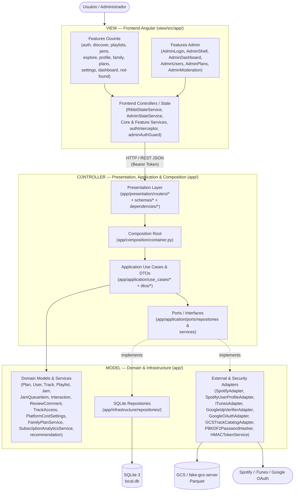

# Ribbit


[](https://github.com/gabrielGAGRA/Laboratorio_Engenharia_Software/actions/workflows/tests.yml)
[](https://github.com/gabrielGAGRA/Laboratorio_Engenharia_Software/actions/workflows/quality-gate.yml)
-brightgreen)
-blue)

### Time: Crazy Frogs
- Carolina Britto Haddad
- Fernando Mendes Seraco
- Gabriel Agra de Castro Motta
- Mateus Silva de Araújo

### Divisão de Responsabilidades da Equipe
- **Gabriel Agra**: Arquitetura hexagonal e estrutura base (refatoração inicial e revisões de PRs); regras de engenharia, linters e type-checking (Python, Angular e TypeScript: Ruff, Pyrefly, Oxlint, ESLint-Angular); testes (pytest, vitest, cobertura >= 85%, E2E Playwright e vídeos) e CI/CD (quality gate e verificação de cobertura); README, badges, histórico de escuta, filtros/ordenação por avaliações, criação de faixas, métricas de interação, painel de custos e analytics de acessos no Admin.
- **Carolina Haddad**: *(a completar)*
- **Fernando Mendes**: *(a completar)*
- **Mateus Araujo**: *(a completar)*

## Sumário
- [Sobre](#sobre)
- [Divisão de Responsabilidades da Equipe](#divisão-de-responsabilidades-da-equipe)
- [Funcionalidades](#funcionalidades)
  - [Aplicativo](#aplicativo)
  - [Painel Administrativo](#painel-administrativo-web)
- [Descrição de Uso do Sistema](#descrição-de-uso-do-sistema)
- [Histórias de Usuário](#histórias-de-usuário)
  - [Definição de Done (DoD)](#definição-de-done-dod)
- [Arquitetura e Tecnologias](#arquitetura-e-tecnologias)
  - [Ferramentas, Bibliotecas, Frameworks e SGBD](#ferramentas-bibliotecas-frameworks-e-sgbd)
  - [Mapeamento MVC e Arquitetura Hexagonal](#mapeamento-mvc-e-arquitetura-hexagonal)
  - [Diagrama de Componentes (MVC + Hexagonal)](#diagrama-de-componentes-mvc--hexagonal)
  - [Diagrama de Classes (UML — Domínio)](#diagrama-de-classes-uml--domínio)
  - [Diagrama Entidade-Relacionamento (DER)](#diagrama-entidade-relacionamento-der)
- [Protótipos da Interface](#protótipos-da-interface)
- [Como Executar (Ubuntu 26.04)](#como-executar-ubuntu-2604)
- [Fluxo de Execução para o Administrador / Avaliador](#fluxo-de-execução-para-o-administrador--avaliador)
- [Como Visualizar](#como-visualizar)
- [Testes Automatizados & Qualidade](#testes-automatizados--qualidade)
  - [Integração Contínua (CI/CD)](#integração-contínua-cicd)
- [Uso de IA](#uso-de-ia)

---

## Sobre

O **Ribbit** redefine a experiência de ouvir novas músicas através de uma mecânica interativa inspirada em *swipe*, usando da geração dinâmica de playlists e sessões colaborativas em tempo real (*Jams*).

O projeto é composto por duas frentes:
1. **Ribbit**: Aplicativo voltado ao usuário final para descoberta, criação de playlists inteligentes e interação social em grupo.
2. **Ribbit Admin Console**: Painel web restrito para curadoria de catálogo com *soft delete*, gestão de planos/usuários e monitoramento de métricas executivas.

---

## Funcionalidades

### Aplicativo

#### 1. Onboarding e Preferências
- Cadastro completo de usuários com validação de dados e autenticação via Google OAuth.
- Seleção personalizada de gêneros e artistas favoritos para alimentar as recomendações.
- Bloqueio de gêneros musicais indesejados, impedindo que faixas associadas exclusivamente a eles apareçam nas Descobertas e Playlists.

#### 2. Descoberta por Swipe
- Feed central de novas faixas que descarta músicas já avaliadas ou gêneros bloqueados.
- Avaliação gestual rápida:
  - **Like (Direita)**: Envia a música para as Curtidas.
  - **Superlike (Cima)**: Adiciona a faixa às Amadas e Curtidas em lista separada.
  - **Rejeitar (Esquerda)**: Remove a música de futuras recomendações e sugestões de playlists.
  - **Desfazer Ação (Premium Ribbit)**: Restaura a última faixa avaliada na Descoberta em caso de toque acidental; disponível nos planos pagos.

#### 3. Playlists Inteligentes e Contextuais
- **Montagem por Swipe**: Modo de adicionar músicas a uma playlist via gestos sem poluir a lista global de Curtidas.
- **Exportação para o Spotify**: Exportação direta da playlist para a biblioteca externa do usuário mediante conexão de conta Spotify (disponível tanto para contas Spotify Free quanto Premium).
- **Duração Exata**: Ajuste algorítmico da duração planejada com margem de erro máxima de $\pm 1$ minuto.
- **Lineup de Festivais**: Geração de sugestões baseada em artistas informados.
- **Filtros por Gênero e Época**: Criação de playlists filtradas por gênero musical e ano/época de lançamento.
- **Modo Referência**: Geração automática com base em Curtidas, Amadas ou playlists prévias.

#### 4. Jams Colaborativas (Pond)
- Criação de salas em grupo com convite por código de 6 dígitos para amigos.
- Sistema de pontuação coletiva por swipe: Like (+1), Deslike (0) e Superlike (+2 com destaque de prioridade).
- Votação democrática para pular músicas da fila em reprodução.
- Acompanhamento do tempo total e restante com margem de tolerância de $\pm 1$ minuto.
- **Sincronização com Fila do Spotify**: Envio em segundo plano das faixas mais votadas diretamente para a fila de reprodução ativa do anfitrião no Spotify.
- **Acesso ao Pond & Validação Spotify**: O recurso de reprodução colaborativa requer Spotify Premium, com tratamento de erros diferenciado na interface entre conta não conectada (modal guiando até as Configurações) e conta sem plano Premium (alerta informativo sem redirecionamento para o plano Ribbit).

#### 5. Busca e Comunidade
- Busca universal por faixa, artista, álbum ou gênero com filtro de nota mínima (`1★+` a `5★`), ordenação por avaliação e enriquecimento dinâmico de capas de álbuns (`cover_url`) com fallback entre GCS, Spotify e iTunes.
- Exibição do selo **Ouvido** em faixas já acessadas pelo usuário nas telas de Descoberta, Busca, Perfil, Coleções, Playlists, Jams e Detalhes da faixa.
- Feed comunitário com ordenação por curtidas, nota e data de publicação.
- Publicação e exclusão de comentários e avaliações comunitárias (1 a 5 estrelas, com opção de nota sem texto obrigatório) em cada música, exibindo metadados e capa da faixa avaliada.

#### 6. Perfil e Dados
- Gestão e edição de listas de Curtidas, Amadas, Rejeitadas e Artistas favoritos.
- Histórico de acessos persistente diretamente no Perfil (`/profile`), registrando reproduções, visualizações de detalhes, buscas, playlists e jams.
- Conexão e desconexão de conta do Spotify com suporte a OAuth e PKCE.
- Dashboard pessoal com artistas principais, gêneros predominantes, entre outras estatísticas.
- Exclusão transparente de dados sob solicitação do usuário.
- Edição e cancelamento do plano de assinatura (planos pagos restritos a maiores de 18 anos; menores podem usar o plano Free ou participar como dependentes no Plano Família).

#### 7. Restrições de conteúdo para menores
- Contas de menores não recebem nem podem interagir com faixas explícitas ou classificadas como Funk, Trap, Rap ou Hip Hop.
- A regra se aplica à descoberta, busca, decks de playlists e Jams, histórico e ações sobre faixas.
- Para menores, a busca externa não é usada como alternativa quando não há resultado local, pois os resultados externos não têm gênero confiável para aplicar o filtro.

---

### Painel Administrativo (Web)

#### 1. Gestão de Catálogo & Soft Delete
- Acesso seguro exclusivo para contas com permissão de administrador (`/admin/login`).
- Cadastro de novos conteúdos (`POST /api/admin/tracks`) com metadados completos diretamente pelo console administrativo (`/admin/moderation`), além de métricas de interação (likes, superlikes, dislikes) por faixa.
- Moderação de faixas (edição de gênero, classificação `+18`/explícita) e remoção de avaliações abusivas.
- **Soft Delete de Conteúdo**: Ao remover uma faixa, ela é ocultada das buscas públicas e das descobertas (`is_deleted = 1`), permanecendo registrada no histórico administrativo de acessos (`/admin/users`, aba **Histórico de Acessos**, com filtro por itens removidos) para integridade de dados e auditoria.

#### 2. Dashboard Executivo e Cálculo de Receita
- Visualização de acessos agrupados por conteúdo e por categoria/gênero no painel `/admin/dashboard`.
- Contagem dinâmica de usuários ativos sincronizada com a base.
- Cálculo da **Receita Líquida** da plataforma com base nas assinaturas ativas e na dedução de custos configuráveis de conteúdo e infraestrutura (`GET/PUT /api/admin/costs`).

#### 3. Gestão de Usuários, Administradores e Planos
- Listagem de assinantes por plano, promoção/rebaixamento de contas elegíveis a administrador e cadastro de novos administradores.
- Edição de planos de assinatura (nome, valor mensal e limite máximo de perfis vinculados).

---

## Descrição de Uso do Sistema

1. **Cadastro e Login**: Na tela inicial (`/auth`), o usuário cria sua conta informando nome, e-mail, data de nascimento, senha e plano inicial (menores de 18 anos podem se cadastrar no plano **Free** ou participar como dependentes no **Plano Família**, enquanto planos pagos exigem maioridade), ou realiza login com uma conta existente.
2. **Descoberta por Swipe (`/discover`)**: O usuário visualiza um card por vez com capa, metadados, selo **Ouvido** (quando já acessada) e prévia de áudio. Pode arrastar ou usar os botões para **Curtir** (direita), **Amar/Superlike** (cima), **Rejeitar** (esquerda), **Desfazer** (planos pagos, restaurando a faixa diretamente do backend) ou adicionar diretamente a uma playlist (`+`).
3. **Playlists Inteligentes (`/playlists`)**: Permite criar playlists com filtros de duração, gênero, artista ou época e montá-las via swipe sem afetar as Curtidas globais, além de gerenciar faixas e exportar para o Spotify.
4. **Jams Colaborativas (`/jams`)**: Usuários com Spotify Premium conectado criam uma sala (recebendo um código de 6 dígitos) ou entram em uma sala ativa para votar nas próximas faixas da fila e votar para pular a faixa atual.
5. **Busca e Comunidade (`/explore`)**: Permite buscar faixas por título, artista, álbum, gênero ou ano, filtrar por nota mínima (`1★+` a `5★`), ordenar por avaliação, ler o feed da comunidade e publicar/excluir avaliações (1 a 5 estrelas) e comentários.
6. **Perfil, Planos e Configurações (`/profile`, `/plans`, `/settings`, `/dashboard`)**: O usuário consulta suas coleções (Curtidas, Amadas, Rejeitadas), seu **Histórico de acessos**, suas avaliações publicadas, altera ou cancela o plano de assinatura, conecta/desconecta o Spotify, bloqueia gêneros indesejados (planos pagos) e visualiza seu dashboard anual.

---

## Histórias de Usuário

As 35 histórias de usuário (HU01–HU35) abaixo consolidam o escopo funcional do projeto, detalhando **tipo de usuário**, **tarefas e subtarefas**, **responsável** e **critérios de aceitação**.

### Definição de Done (DoD)

Uma história de usuário é considerada **Done** apenas quando atende a todos os critérios abaixo:
- [ ] **Código e Arquitetura:** Implementação aderente à arquitetura hexagonal (`app/`) e standalone/Signals (`view/`), revisada via Pull Request.
- [ ] **Qualidade Estática:** Aprovado no *Quality Gate* sem erros (`ruff format --check`, `ruff check`, `pyrefly check`, `npm run lint`, `npm run typecheck`).
- [ ] **Testes e Cobertura:** Testes unitários e/ou de integração cobrindo os critérios de aceitação, mantendo cobertura $\ge 85\%$ (`pytest --cov=app --cov-fail-under=85` e `vitest --coverage`).
- [ ] **Validação E2E e Documentação:** Fluxos principais validados em navegador (`npm run test:e2e`) e documentação (`README.md`, `docs/database/`) atualizada quando aplicável.

### Épico 1 — Cadastro e Preferências

| ID | Título | Tipo de Usuário | Tarefas e Subtarefas | Responsável | Critérios de Aceitação |
| :--- | :--- | :--- | :--- | :--- | :--- |
| **HU01** | Criar conta | Novo Usuário | **Backend:** Endpoint `POST /api/auth/register`, hash PBKDF2 e validação Pydantic.<br>**Frontend:** Tela de cadastro (`AuthComponent`) com validação de e-mail, senha e idade. | Gabriel Agra | • Consegue criar conta com solicitação e validação de dados.<br>• Acessa a conta imediatamente após o cadastro. |
| **HU02** | Definir preferências musicais | Novo Usuário | **Backend:** Persistência de `favorite_genres` em `users` e endpoint de atualização.<br>**Frontend:** Seleção de gêneros e artistas favoritos no perfil/onboarding. | Carolina Haddad | • Seleciona gêneros e artistas de interesse.<br>• Preferências são salvas no perfil e usadas nas recomendações. |
| **HU03** | Bloquear gêneros musicais | Usuário Padrão | **Backend:** Campo `blocked_genres` no modelo `User` e filtro em `recommendation.py` (`select_weighted_track`, `order_tracks_by_weighted_seed`).<br>**Frontend:** Gestão de gêneros bloqueados em Configurações/Perfil. | Carolina Haddad | • Adiciona e remove gêneros bloqueados.<br>• Faixas exclusivamente desses gêneros não aparecem em Descobertas nem Playlists. |

### Épico 2 — Descoberta de Músicas

| ID | Título | Tipo de Usuário | Tarefas e Subtarefas | Responsável | Critérios de Aceitação |
| :--- | :--- | :--- | :--- | :--- | :--- |
| **HU04** | Descobrir músicas | Usuário Padrão | **Backend:** Caso de uso `GetNextDiscoveryTrackUseCase` e rota `/api/discovery/next`.<br>**Frontend:** Deck de cartões com suporte a swipe em `DiscoverComponent`. | Gabriel Agra | • Sugere apenas faixas inéditas (fora de Curtidas, Amadas e Rejeitadas).<br>• Respeita preferências e gêneros bloqueados.<br>• Apresenta nova faixa após cada swipe. |
| **HU05** | Curtir uma música | Usuário Padrão | **Backend:** `RecordSwipeInteractionUseCase` gravando `action='like'`.<br>**Frontend:** Gesto de swipe para a direita / botão Like e listagem em `/likes`. | Fernando Seraco | • Dá like e salva a faixa em Curtidas.<br>• Faixa não retorna como descoberta inédita e fica visível em Curtidas. |
| **HU06** | Amar uma música | Usuário Padrão | **Backend:** `RecordSwipeInteractionUseCase` gravando `action='superlike'`.<br>**Frontend:** Gesto de swipe para cima / botão Superlike e listagem em `/loved`. | Fernando Seraco | • Dá superlike e adiciona a faixa às Amadas e Curtidas.<br>• Não reaparece na descoberta; visualizada separadamente em Amadas. |
| **HU07** | Rejeitar uma música | Usuário Padrão | **Backend:** `RecordSwipeInteractionUseCase` gravando `action='dislike'`.<br>**Frontend:** Gesto de swipe para a esquerda / botão Rejeitar e listagem em `/rejected`. | Mateus Araújo | • Rejeita a faixa e a envia para Rejeitadas.<br>• Não retorna em Descobertas nem sugestões de Playlists.<br>• Listagem consultável pelo usuário. |
| **HU08** | Descobrir músicas a partir das preferências | Usuário Padrão | **Backend:** Ponderação em `recommendation.py` (`select_weighted_track`, `order_tracks_by_weighted_seed`) por artistas/gêneros curtidos e amados.<br>**Frontend:** Atualização dinâmica do feed em `DiscoverComponent`. | Gabriel Agra | • Considera Curtidas, Amadas, artistas e gêneros favoritos.<br>• Exclui Rejeitadas e gêneros bloqueados.<br>• Permite avaliação por swipe. |

### Épico 3 — Playlists Inteligentes e Contextuais

| ID | Título | Tipo de Usuário | Tarefas e Subtarefas | Responsável | Critérios de Aceitação |
| :--- | :--- | :--- | :--- | :--- | :--- |
| **HU09** | Criar playlist | Usuário Padrão | **Backend:** CRUD de playlists em `playlists.py` e cálculo `total_duration_seconds`.<br>**Frontend:** Modal/tela de criação e edição em `PlaylistsComponent`. | Mateus Araújo | • Cria, edita e exclui playlist com nome e descrição.<br>• Adiciona/remove faixas e exibe duração total. |
| **HU10** | Adicionar músicas à playlist por swipe | Usuário Padrão | **Backend:** `GetPlaylistDeckUseCase` e `AddTrackToPlaylistUseCase` isolados de Curtidas globais.<br>**Frontend:** Deck de swipe contextual dentro da playlist. | Mateus Araújo | • Sugere faixas fora de Rejeitadas.<br>• Like adiciona só à playlist; Superlike adiciona à playlist e Amadas.<br>• Rejeição na sessão não polui Rejeitadas globais e não repete na sessão. |
| **HU11** | Criar playlist a partir de referências | Usuário Padrão | **Backend:** `CreateDeckPlaylistUseCase` aceitando `source_playlist_id` e filtros de referência.<br>**Frontend:** Seletor de Curtidas, Amadas ou playlists existentes como base. | Carolina Haddad | • Seleciona Curtidas, Amadas ou playlists como referência.<br>• Gera sugestões relacionadas avaliáveis por swipe para adicionar à nova playlist. |
| **HU12** | Criar playlist com duração definida | Usuário Padrão | **Backend:** `max_duration_seconds` na entidade `Playlist` e ajuste no deck.<br>**Frontend:** Campo de duração desejada e barra de progresso/tempo restante. | Gabriel Agra | • Define duração desejada; exibe duração atual e restante.<br>• Sugestões respeitam tolerância máxima de ±1 minuto. |
| **HU13** | Criar playlist baseada em lineup | Usuário Padrão | **Backend:** Filtragem/ranqueamento por artistas em `deck_filters`.<br>**Frontend:** Entrada de artistas para lineup de festival/show. | Fernando Seraco | • Informa artistas; sistema identifica e sugere faixas relacionadas.<br>• Permite adicionar via swipe. |
| **HU14** | Criar playlist baseada em época | Usuário Padrão | **Backend:** Filtro por `release_year`/década em `deck_filters`.<br>**Frontend:** Seletor de época no criador contextual. | Mateus Araújo | • Informa época; recebe sugestões relacionadas para adicionar via swipe. |

### Épico 4 — Jams Colaborativas (Pond)

| ID | Título | Tipo de Usuário | Tarefas e Subtarefas | Responsável | Critérios de Aceitação |
| :--- | :--- | :--- | :--- | :--- | :--- |
| **HU15** | Criar uma Jam e convidar amigos | Usuário Padrão | **Backend:** `CreateJamUseCase` e `JoinJamUseCase` com `room_code` de 6 dígitos.<br>**Frontend:** Criação/entrada em sala em `JamsComponent`. | Gabriel Agra | • Cria Jam, compartilha código e participantes entram, avaliam e veem a fila atualizada. |
| **HU16** | Adicionar músicas à Jam por swipe | Participante de Jam | **Backend:** `VoteJamTrackUseCase` registrando like, superlike e deslike.<br>**Frontend:** Deck de swipe dentro da sala de Jam. | Gabriel Agra | • Participante dá like, superlike ou deslike; avaliação é registrada e altera pontuação da faixa. |
| **HU17** | Organizar a Jam pelas avaliações | Participante de Jam | **Backend:** Ordenação da `JamQueueItem` por `vote_points` (+1 like, +2 superlike, 0 deslike).<br>**Frontend:** Fila reordenada dinamicamente. | Fernando Seraco | • Like soma +1, deslike soma 0, superlike soma +2 com prioridade.<br>• Fila reordena conforme votos de todos os participantes. |
| **HU18** | Votar para pular uma música | Participante de Jam | **Backend:** `VoteSkipJamTrackUseCase` e `skip_votes_threshold` configurável pelo host.<br>**Frontend:** Botão de pular faixa com contador de votos. | Fernando Seraco | • Contabiliza votos; ao atingir limite definido pelo criador, pula a faixa e informa participantes. |
| **HU19** | Acompanhar o tempo da Jam | Participante de Jam | **Backend:** `duration_minutes`, `accumulated_duration_seconds` e `AdvanceJamPlaybackUseCase`.<br>**Frontend:** Indicadores de duração planejada, reproduzida e restante. | Gabriel Agra | • Exibe tempo planejado, reproduzido e restante atualizados em tempo real, com margem de ±1 minuto. |

### Épico 5 — Busca e Avaliações

| ID | Título | Tipo de Usuário | Tarefas e Subtarefas | Responsável | Critérios de Aceitação |
| :--- | :--- | :--- | :--- | :--- | :--- |
| **HU20** | Buscar músicas | Usuário Padrão | **Backend:** Busca unificada em `tracks_reviews.py` com enriquecimento GCS/Spotify/iTunes.<br>**Frontend:** Barra de busca e filtros em `ExploreComponent`. | Carolina Haddad | • Pesquisa por música, artista, álbum, gênero ou ano e adiciona resultados a playlists. |
| **HU21** | Avaliar uma música | Usuário Padrão | **Backend:** `ReviewComment` (nota 1–5) e `PublishReviewUseCase`.<br>**Frontend:** Seletor de nota no modal de detalhes da faixa. | Fernando Seraco | • Registra avaliação vinculada ao usuário e à música. |
| **HU22** | Comentar uma música | Usuário Padrão | **Backend:** Endpoints de criação e exclusão lógica de comentários em `tracks_reviews.py`.<br>**Frontend:** Formulário e ação de excluir comentário próprio. | Fernando Seraco | • Publica e exclui o próprio comentário associado à faixa. |
| **HU23** | Visualizar avaliações e comentários | Usuário Padrão | **Backend:** `GetTrackReviewsUseCase` e `GetCommunityFeedUseCase`.<br>**Frontend:** Feed comunitário e lista de reviews por música. | Mateus Araújo | • Exibe avaliações e comentários publicados na plataforma. |

### Épico 6 — Perfil, Playlists, Assinaturas e Dados

| ID | Título | Tipo de Usuário | Tarefas e Subtarefas | Responsável | Critérios de Aceitação |
| :--- | :--- | :--- | :--- | :--- | :--- |
| **HU24** | Visualizar meu perfil musical | Usuário Padrão | **Backend:** `GetUserProfileUseCase`, `ListUserAccessHistoryUseCase` e listagens em `profile.py`.<br>**Frontend:** `ProfileComponent` (abas Curtidas, Amadas, Rejeitadas e Histórico) e `CollectionComponent` (`/likes`, `/loved`, `/rejected`). | Carolina Haddad | • Visualiza Curtidas, Amadas, Rejeitadas, Histórico de acessos (Ouvidas) e playlists. |
| **HU25** | Visualizar estatísticas e dashboard | Usuário Padrão | **Backend:** `GetAnnualListeningStatsUseCase` e `SQLiteUserStatsRepository`.<br>**Frontend:** `DashboardComponent` (`/dashboard`). | Mateus Araújo | • Apresenta principais artistas, gêneros predominantes e estatísticas de uso. |
| **HU26** | Gerenciar playlists | Usuário Padrão | **Backend:** `ListUserPlaylistsUseCase`, `AddTrackToPlaylistUseCase`, `RemoveTrackFromPlaylistUseCase` e `DeletePlaylistUseCase`.<br>**Frontend:** Lista e detalhes de playlists com remoção. | Mateus Araújo | • Visualiza, adiciona/remove músicas e exclui playlists. |
| **HU27** | Editar meus dados e preferências | Usuário Padrão | **Backend:** `UpdateProfileUseCase` e `UpdatePreferredThemeUseCase`.<br>**Frontend:** `SettingsComponent` (`/settings`). | Carolina Haddad | • Visualiza e edita dados cadastrais e preferências com validação e persistência. |
| **HU28** | Excluir meus dados | Usuário Padrão | **Backend:** Remoção de interações e dados pessoais via `DeleteUserAccountUseCase`.<br>**Frontend:** Fluxo de confirmação em Configurações/Perfil. | Gabriel Agra | • Informa que os dados serão removidos, exige confirmação, exclui e notifica conclusão. |
| **HU29** | Desfazer swipe | Usuário Pagante | **Backend:** `UndoLatestDiscoveryInteractionUseCase` em `discovery.py`.<br>**Frontend:** Botão "Desfazer" na tela de Descoberta (planos pagos). | Fernando Seraco | • Desfaz a última ação, restaura estado anterior e exibe a faixa novamente. |
| **HU30** | Planos e verificação de idade | Novo Usuário | **Backend:** `Plan`, `User.is_minor()` e validação de maioridade (18+) para titular e planos pagos (Individual/Família).<br>**Frontend:** Escolha entre planos em `PlansComponent`, checkout e cadastro em `AuthComponent`. | Gabriel Agra | • Seleciona Plano Free, Individual ou Familiar; valida 18+ para planos pagos/titular e registra plano no perfil. |
| **HU31** | Gestão de perfis na assinatura familiar | Titular de Plano Familiar | **Backend:** `FamilyPlanService`, `AddFamilyMemberUseCase`, `RemoveFamilyMemberUseCase` (até 4 perfis) e filtro de menoridade.<br>**Frontend:** Gerenciamento de dependentes em `FamilyComponent` (`/family`) e restrição etária. | Gabriel Agra | • Cadastra até 4 perfis independentes (1 titular + até 3 dependentes) com histórico/curtidas isolados.<br>• Bloqueia faixas explícitas e de Funk/Trap/Rap/Hip Hop para menores. |
| **HU32** | Gerenciar e cancelar assinatura | Assinante | **Backend:** `ChangeSubscriptionPlanUseCase` e `CancelSubscriptionPlanUseCase`.<br>**Frontend:** Status do plano e cancelamento em `/plans`, `/profile` e `/settings`. | Fernando Seraco | • Consulta status/plano e solicita cancelamento retornando ao plano Free.<br>• Atualiza status do plano. |
| **HU33** | Encerrar e excluir conta | Usuário Padrão | **Backend:** `DeleteUserAccountUseCase` e desvinculação de dependentes.<br>**Frontend:** Seção "Excluir conta" com modal de confirmação em `/settings` e `/profile`. | Gabriel Agra | • Cancela assinatura vinculada; revoga dependentes de plano familiar e remove dados. |

### Épico 7 — Administração e Governança

| ID | Título | Tipo de Usuário | Tarefas e Subtarefas | Responsável | Critérios de Aceitação |
| :--- | :--- | :--- | :--- | :--- | :--- |
| **HU34** | Gestão de catálogo (Cadastro & Soft Delete) | Administrador | **Backend:** `CreateTrackUseCase`, `BlockTrackUseCase`, `UpdateTrackGenreUseCase`, `UpdateTrackExplicitFlagUseCase`, `ListAdminAccessHistoryUseCase` e `is_deleted` em `tracks`.<br>**Frontend:** `AdminModerationComponent` (`/admin/moderation`), `AdminUsersComponent` (`/admin/users` — Histórico de Acessos) e guarda `adminAuthGuard`. | Fernando Seraco | • Área restrita a administradores.<br>• Permite cadastro de faixas, curadoria de metadados e remoção lógica (*Soft Delete*), ocultando a faixa das buscas públicas enquanto preserva o histórico administrativo. |
| **HU35** | Dashboard ADM e cálculo de receita | Administrador | **Backend:** `GetExecutiveDashboardUseCase`, `GetAudienceReportUseCase`, `GetPlatformCostsUseCase`, `UpdatePlatformCostsUseCase` e `SubscriptionAnalyticsService`.<br>**Frontend:** `AdminDashboardComponent` (`/admin/dashboard`). | Mateus Araújo | • Exibe total de usuários ativos, planos, acessos por conteúdo/gênero e Receita Líquida descontando custos configuráveis de conteúdo e infraestrutura. |

---

## Arquitetura e Tecnologias

### Ferramentas, Bibliotecas, Frameworks e SGBD

#### Linguagens e Runtimes
| Tecnologia | Versão Exata | Finalidade |
| :--- | :--- | :--- |
| **Python** | `3.15` (`requires-python >= 3.15`) | Linguagem principal do backend, regras de domínio e testes |
| **TypeScript** | `6.0.2` (`npm:@typescript/typescript6@^6.0.2`) & `7.0.2` (`tsc --noEmit`) | Linguagem principal do frontend Angular e checagem estrita de tipos |
| **Node.js** | `22.x` (`node:22-bookworm-slim`) | Runtime de build, testes e servidor de desenvolvimento do frontend |

#### Backend (Python — `requirements.txt` & `pyproject.toml`)
| Biblioteca / Framework | Versão Exata | Finalidade |
| :--- | :--- | :--- |
| **FastAPI** | `0.163.1` | Framework web REST, roteamento e geração OpenAPI (`/docs`) |
| **Uvicorn** | `0.54.0` | Servidor ASGI para execução da API |
| **Pydantic** + **email-validator** | `2.14.3` (`pydantic-core==2.50.4`, `email-validator==2.4.0`) | Validação de esquemas de entrada/saída e configurações |
| **Starlette** + **AnyIO** | `1.10.0` / `4.16.0` | Camada ASGI subjacente e primitivos assíncronos |
| **Niquests** | `3.21.3` | Cliente HTTP para integrações externas (Spotify, iTunes, Google OAuth) |
| **Google Cloud Storage** | `3.17.1` | Leitura/compactação de catálogo no GCS e emulador local (`fake-gcs-server`) |
| **PyArrow** | `26.0.1` | Leitura e escrita do catálogo musical em formato Apache Parquet |
| **Pillow** | `13.0.0` | Processamento e validação de imagens de capa de playlists |
| **python-dotenv** | `1.2.4` | Carregamento de variáveis de ambiente via `.env` |

#### Frontend (TypeScript / Angular — `package.json`)
| Biblioteca / Framework | Versão Exata | Finalidade |
| :--- | :--- | :--- |
| **Angular** (`core`, `common`, `compiler`, `forms`, `platform-browser`, `router`) | `^22.2.3` | Framework SPA com componentes standalone e Signals |
| **Angular CLI & Build** (`@angular/cli`, `@angular-devkit/build-angular`) | `^22.2.4` | Empacotamento, proxy local da API e servidor `ng serve` |
| **RxJS** | `^7.8.2` | Programação reativa e interceptors HTTP |

#### SGBD e Armazenamento
| Tecnologia | Versão / Imagem | Finalidade |
| :--- | :--- | :--- |
| **SQLite 3** | `3.45+` (nativo no Python 3.15 / pacote `sqlite3` Ubuntu 26.04) | Banco relacional local/cache por instância; usado sozinho no desenvolvimento |
| **Google Cloud Firestore** | Firestore REST v1 | Sincronização compartilhada dos dados persistentes quando `FIRESTORE_ENABLED=true` no deploy |
| **fake-gcs-server (Emulador GCS)** | `fsouza/fake-gcs-server:latest` | Emulação local de bucket Google Cloud Storage para catálogo `.parquet` |

#### Infraestrutura, Qualidade, Linting, Tipagem e Testes
| Ferramenta | Versão Exata | Finalidade |
| :--- | :--- | :--- |
| **Docker Engine & Docker Compose** | `docker.io` `24.x+` / `docker-compose-v2` (`v2.x+`) / `nginx:alpine` | Orquestração local dos containers (`backend`, `frontend` servido via `nginx:alpine` e `gcs-emulator`) |
| **Pytest** + **pytest-cov** + **coverage** + **Hypothesis** | `9.2.0` / `7.1.0` / `7.17.3` / `6.170.17` | Suíte de testes unitários, propriedade e integração da API do backend (1007 testes, 89.21% de cobertura) |
| **Playwright** + **ffmpeg** | `1.65.1` (`@playwright/test`) / `ffmpeg` (Ubuntu) | Testes funcionais ponta a ponta no navegador e gravação de vídeos de execução (`npm run record:e2e`) |
| **Vitest** + **@vitest/coverage-v8** + **JSDOM** | `5.1.2` / `5.1.2` / `26.1.0` | Suíte de testes unitários e cobertura do frontend Angular (300 testes em 45 arquivos, 87.27% de linhas) |
| **Ruff** | `0.17.5` | Linter e formatador Python |
| **Pyrefly** | `1.4.1` | Verificador estático de tipos Python (`preset = "strict"`) |
| **Oxlint** + **oxlint-tsgolint** + **Oxfmt** | `1.88.0` / `7.0.2004` / `0.73.0` | Linting *type-aware* e formatação TypeScript/HTML/CSS |
| **ESLint** + **angular-eslint** | `10.13.0` / `22.6.0` | Regras de lint específicas para templates e componentes Angular |
| **uv** | `0.13.1` | Gerenciador de pacotes e ambientes Python |

> **Nota sobre a evolução da especificação:** Os diagramas iniciais do documento de especificação (*Tecnologia-Arquitetura*) previam Redis/DynamoDB e Deezer em nível conceitual. A implementação usa **SQLite 3** como banco local/cache, **Firestore** para sincronização dos dados persistentes em produção, **GCS/Parquet** para o catálogo, **Spotify + iTunes** como APIs externas e **Angular 22 + FastAPI**, documentados nos diagramas atualizados abaixo.

---

### Mapeamento MVC e Arquitetura Hexagonal

O projeto combina **MVC (Model-View-Controller)** na divisão macro entre frontend e backend com **Arquitetura Hexagonal (Ports & Adapters)** e **DDD** dentro de `app/`:

| Camada MVC | Diretórios no Repositório | Responsabilidade e Coerência com o Código |
| :--- | :--- | :--- |
| **View** | `view/src/app/features/`<br>`view/src/app/shared/` | Interface SPA em Angular (componentes standalone, templates `.html`, estilos `.css`). Inclui as telas de autenticação/ouvinte (`auth`, `discover`, `playlists`, `jams`, `explore`, `profile` + `collection`, `family`, `plans`, `settings`, `dashboard`, `not-found`), os componentes compartilhados (`shared/`) e o painel administrativo (`admin/*`: `admin-login`, `admin-shell`, `admin-dashboard`, `admin-users`, `admin-plans`, `admin-moderation`). |
| **Controller** | `app/presentation/routers/`<br>`app/presentation/schemas/`<br>`app/presentation/dependencies/`<br>`app/application/use_cases/`<br>`app/application/dtos/`<br>`app/composition/`<br>`view/src/app/core/`<br>`view/src/app/features/*/*.service.ts` | **Backend:** Routers FastAPI (`auth.py`, `discovery.py`, `playlists.py`, `jams.py`, `tracks_reviews.py`, `profile.py`, `spotify.py`, `admin.py`) recebem requisições HTTP/REST, validam schemas Pydantic (`schemas/`) e delegam aos *Use Cases* (`use_cases/`), com injeção de dependências centralizada no *Composition Root* (`app/composition/container.py`).<br>**Frontend:** Serviços Angular com Signals, interceptors e guards (`RibbitStateService`, `SongService`, `PlaylistService`, `PlanService`, `AudioPlayerService`, `AuthSessionNotifier`, `authInterceptor` em `core/`, além de `AdminStateService`, `adminAuthGuard`, `DashboardService`, `JamService`, `AuthApiService`, `ProfileApiService` em `features/`). |
| **Model** | `app/domain/models/`<br>`app/domain/services/`<br>`app/application/ports/`<br>`app/infrastructure/` | **Domínio Puro:** Entidades/modelos (`Plan`, `User`, `Track`, `Playlist`, `Jam`, `JamQueueItem`, `Interaction`, `ReviewComment`, `TrackAccess`, `PlatformCostSettings`) e serviços/funções de domínio (`FamilyPlanService`, `SubscriptionAnalyticsService`, funções de recomendação em `recommendation.py`).<br>**Persistência & Adapters:** Repositórios SQLite (`SQLite*Repository`), adapters externos (`SpotifyAdapter`, `SpotifyUserProfileAdapter`, `ITunesAdapter`, `GoogleIdpVerifierAdapter`, `GoogleOAuthAdapter`, `GCSTrackCatalogAdapter`) e segurança (`PBKDF2PasswordHasher`, `HMACTokenService`) implementam os *ports*. |

---

### Diagrama de Componentes (MVC + Hexagonal)



---

### Diagrama de Classes (UML — Domínio)

O diagrama abaixo representa as entidades de domínio implementadas em `app/domain/models/`, com seus atributos principais, métodos de negócio e relacionamentos:

```mermaid
classDiagram
    class Plan {
        +int? plan_id
        +str name
        +float monthly_price
        +int max_profiles
        +bool is_paid
        +bool allows_dependents
        +can_accommodate(total_profiles: int) bool
        +can_accommodate_new_dependent(current_dependents: int) bool
        +update_name(new_name: str) Plan
        +update_price(new_price: float) Plan
        +update_max_profiles(new_max: int) Plan
    }

    class User {
        +int? user_id
        +str email
        +str password_hash
        +str display_name
        +int? age
        +str? birth_date
        +int plan_id
        +int? primary_account_id
        +frozenset~str~ blocked_genres
        +frozenset~str~ favorite_genres
        +str preferred_theme
        +bool is_admin
        +str? spotify_id
        +bool spotify_premium
        +str? spotify_access_token
        +str? spotify_refresh_token
        +datetime? spotify_token_expires_at
        +datetime? created_at
        +bool is_adult
        +current_age(today: date?) int
        +is_minor() bool
        +restricted_genre_terms() tuple~str~
        +can_listen(track: Track) bool
        +is_track_restricted_for_minor(track: Track) bool
        +link_primary_account(primary_account_id: int) User
        +unlink_primary_account(fallback_plan_id: int) User
        +change_plan(plan_id: int) User
        +promote_to_admin() User
        +link_spotify(spotify_id: str) User
        +unlink_spotify() User
        +update_spotify_premium(is_premium: bool) User
        +update_spotify_tokens(access_token: str?, refresh_token: str?, expires_at: datetime?) User
        +update_blocked_genres(genres: Iterable~str~) User
        +update_favorite_genres(genres: Iterable~str~) User
        +update_preferred_theme(theme: str) User
        +update_profile(display_name: str?, password_hash: str?) User
        +is_favorite_genre(track: Track) bool
        +recommendation_weight(track: Track, favorite_multiplier: float?) float
    }

    class Track {
        +int? track_id
        +str title
        +str artist
        +int duration_seconds
        +str genre
        +str? spotify_id
        +str? album
        +str? country
        +int? release_year
        +str? cover_url
        +str? itunes_preview_url
        +bool explicit
        +bool is_deleted
        +datetime? created_at
        +float? average_rating
        +int review_count
        +set_explicit(explicit: bool) Track
        +has_known_genre() bool
        +set_genre(genre: str) Track
        +merge_missing_metadata(...) bool
        +refresh_catalog_metadata(...) Track
        +mark_as_deleted() Track
        +restore() Track
    }

    class Playlist {
        +int? playlist_id
        +int user_id
        +str name
        +str? description
        +str? spotify_playlist_id
        +str? cover_image_url
        +bool is_exported
        +datetime? created_at
        +int? max_duration_seconds
        +str? deck_filters
        +int? source_playlist_id
        +tuple~Track~ tracks
        +int total_duration_seconds
        +is_owned_by(user_id: int) bool
        +can_fit_duration(additional_seconds: int) bool
        +add_track(track: Track) Playlist
        +remove_track(track_id: int) Playlist
        +replace_tracks(tracks: Sequence~Track~) Playlist
        +export(spotify_playlist_id: str) Playlist
    }

    class Jam {
        +int? jam_id
        +int host_user_id
        +str room_name
        +str room_code
        +bool is_active
        +int? current_track_id
        +datetime? created_at
        +int duration_minutes
        +int max_superlikes
        +int superlikes_used
        +int skip_votes_threshold
        +int accumulated_duration_seconds
        +str deck_source
        +int? source_playlist_id
        +int max_duration_seconds
        +generate_room_code() str
        +create(host_user_id: int, room_name: str, ...) Jam
        +is_host(user_id: int) bool
        +can_use_superlike() bool
        +use_superlike() Jam
        +is_duration_exceeded() bool
        +add_accumulated_duration(seconds: int) Jam
        +set_current_track(track_id: int?) Jam
        +close() Jam
    }

    class JamQueueItem {
        +int? jam_queue_id
        +int jam_id
        +int track_id
        +int vote_points
        +datetime? added_at
        +vote(points: int) JamQueueItem
    }

    class Interaction {
        +int? interaction_id
        +int user_id
        +int track_id
        +InteractionAction action
        +InteractionSource? source
        +int? jam_id
        +datetime? created_at
        +bool is_positive
        +change_action(new_action: InteractionAction) Interaction
    }

    class ReviewComment {
        +int? review_id
        +int user_id
        +int track_id
        +int rating
        +str? text
        +int likes_count
        +bool is_deleted
        +datetime? created_at
        +str? author_name
        +str? track_title
        +str? track_artist
        +str? track_image
        +is_valid_rating(rating: int) bool
        +like() ReviewComment
        +mark_as_deleted() ReviewComment
        +update_content(new_rating: int, new_text: str?) ReviewComment
    }

    class TrackAccess {
        +int? access_id
        +int user_id
        +int track_id
        +TrackAccessSource source
        +datetime? accessed_at
    }

    class PlatformCostSettings {
        +float content_cost_per_track
        +float infrastructure_fixed_cost
        +float infrastructure_cost_per_user
        +datetime? updated_at
    }

    Plan "1" <-- "0..*" User : assina
    User "0..1" <-- "0..*" User : titular / dependente
    User "1" --> "0..*" Playlist : possui
    Playlist "0..*" o-- "0..*" Track : contém
    Playlist "0..1" <-- "0..*" Playlist : referencia
    User "1" --> "0..*" Jam : hospeda
    Jam "1" *-- "0..*" JamQueueItem : fila
    JamQueueItem "0..*" --> "1" Track : referencia
    Jam "0..*" --> "0..1" Track : faixa atual
    Jam "0..*" --> "0..1" Playlist : deck base
    User "1" --> "0..*" Interaction : realiza
    Track "1" <-- "0..*" Interaction : avaliada em
    Jam "0..1" <-- "0..*" Interaction : origem
    User "1" --> "0..*" ReviewComment : publica
    Track "1" <-- "0..*" ReviewComment : recebe
    User "1" --> "0..*" TrackAccess : registra acesso
    Track "1" <-- "0..*" TrackAccess : acessada em
```



---

### Diagrama Entidade-Relacionamento (DER)

O esquema relacional completo do SQLite está implementado em [`app/infrastructure/repositories/schema.sql`](app/infrastructure/repositories/schema.sql), documentado em DBML em [`docs/database/DER.sql`](docs/database/DER.sql) e nos módulos SQL em [`docs/database/`](docs/database/), sendo representado tanto pelo diagrama estático [`DER.png`](docs/database/DER.png) quanto pelo diagrama Mermaid abaixo:

```mermaid
erDiagram
    plans {
        INTEGER plan_id PK
        TEXT name UK
        REAL monthly_price
        INTEGER max_profiles
    }

    users {
        INTEGER user_id PK
        TEXT email UK
        TEXT password_hash
        TEXT spotify_id UK
        INTEGER spotify_premium
        TEXT spotify_access_token
        TEXT spotify_refresh_token
        TEXT spotify_token_expires_at
        TEXT display_name
        INTEGER age
        INTEGER plan_id FK
        INTEGER primary_account_id FK
        TEXT blocked_genres
        TEXT favorite_genres
        TEXT preferred_theme
        INTEGER is_admin
        TEXT created_at
        TEXT birth_date
    }

    tracks {
        INTEGER track_id PK
        TEXT spotify_id
        TEXT title
        TEXT artist
        INTEGER duration_seconds
        TEXT genre
        TEXT country
        INTEGER release_year
        TEXT cover_url
        TEXT itunes_preview_url
        INTEGER explicit
        INTEGER is_deleted
        TEXT created_at
    }

    interactions {
        INTEGER interaction_id PK
        INTEGER user_id FK
        INTEGER track_id FK
        TEXT action
        TEXT created_at
        TEXT source
        INTEGER jam_id FK
    }

    playlists {
        INTEGER playlist_id PK
        INTEGER user_id FK
        TEXT name
        TEXT description
        TEXT spotify_playlist_id
        INTEGER is_exported
        TEXT created_at
        INTEGER max_duration_seconds
        TEXT deck_filters
        TEXT cover_image_url
        INTEGER source_playlist_id
    }

    playlist_images {
        INTEGER playlist_id PK,FK
        TEXT content_type
        BLOB image_data
        TEXT updated_at
    }

    playlist_tracks {
        INTEGER playlist_track_id PK
        INTEGER playlist_id FK
        INTEGER track_id FK
        TEXT added_at
    }

    jams {
        INTEGER jam_id PK
        INTEGER host_user_id FK
        TEXT room_name
        TEXT room_code UK
        INTEGER is_active
        INTEGER current_track_id FK
        TEXT created_at
        INTEGER duration_minutes
        INTEGER max_superlikes
        INTEGER superlikes_used
        INTEGER skip_votes_threshold
        INTEGER accumulated_duration_seconds
        TEXT deck_source
        INTEGER source_playlist_id
    }

    jam_queue_items {
        INTEGER jam_queue_id PK
        INTEGER jam_id FK
        INTEGER track_id FK
        INTEGER vote_points
        TEXT added_at
    }

    jam_participants {
        INTEGER jam_id PK,FK
        INTEGER user_id PK,FK
        TEXT joined_at
    }

    jam_skip_votes {
        INTEGER jam_id PK,FK
        INTEGER track_id PK,FK
        INTEGER user_id PK,FK
        TEXT voted_at
    }

    reviews {
        INTEGER review_id PK
        INTEGER user_id FK
        INTEGER track_id FK
        INTEGER rating
        TEXT text
        INTEGER likes_count
        INTEGER is_deleted
        TEXT created_at
    }

    review_likes {
        INTEGER review_id PK,FK
        INTEGER user_id PK,FK
        TEXT created_at
    }

    track_accesses {
        INTEGER access_id PK
        INTEGER user_id FK
        INTEGER track_id FK
        TEXT source
        TEXT accessed_at
    }

    audit_logs {
        INTEGER log_id PK
        TEXT event
        TEXT status
        TEXT created_at
    }

    platform_cost_settings {
        INTEGER settings_id PK
        REAL content_cost_per_track
        REAL infrastructure_fixed_cost
        REAL infrastructure_cost_per_user
        TEXT updated_at
    }

    plans ||--o{ users : "assina"
    users o|--o{ users : "titular_dependente"
    users ||--o{ playlists : "possui"
    playlists o|--o{ playlists : "origem"
    playlists ||--o| playlist_images : "capa"
    playlists ||--o{ playlist_tracks : "contem"
    tracks ||--o{ playlist_tracks : "integra"
    users ||--o{ interactions : "registra"
    tracks ||--o{ interactions : "recebe"
    jams o|--o{ interactions : "origem_jam"
    users ||--o{ jams : "hospeda"
    tracks o|--o{ jams : "toca_atual"
    playlists o|--o{ jams : "deck_base"
    jams ||--o{ jam_queue_items : "enfileira"
    tracks ||--o{ jam_queue_items : "na_fila"
    jams ||--o{ jam_participants : "participa"
    users ||--o{ jam_participants : "entra"
    jams ||--o{ jam_skip_votes : "voto_pulo"
    tracks ||--o{ jam_skip_votes : "pulada_em"
    users ||--o{ jam_skip_votes : "vota_pular"
    users ||--o{ reviews : "escreve"
    tracks ||--o{ reviews : "avaliada_em"
    reviews ||--o{ review_likes : "curtida_em"
    users ||--o{ review_likes : "curte_review"
    users ||--o{ track_accesses : "acessa"
    tracks ||--o{ track_accesses : "acessada_em"
```



---

## Protótipos da Interface

Os protótipos de alta e baixa fidelidade das telas do aplicativo e do fluxo de swipe estão disponíveis no repositório:
- **Protótipo de Telas (PDF completo):** [`docs/view/prototype/Protótipo de Telas Ribbit.pdf`](docs/view/prototype/Protótipo%20de%20Telas%20Ribbit.pdf)
- **Ideação Crazy 8 (rascunhos iniciais da equipe):**
  - [`Crazy8.jpeg`](docs/view/prototype/Crazy8.jpeg) — Consolidação
  - [`Crazy8-Carol.jpeg`](docs/view/prototype/Crazy8-Carol.jpeg) — Carolina Britto Haddad
  - [`Crazy8-Fernando.jpeg`](docs/view/prototype/Crazy8-Fernando.jpeg) — Fernando Mendes Seraco
  - [`Crazy8-Gabriel.jpeg`](docs/view/prototype/Crazy8-Gabriel.jpeg) — Gabriel Agra de Castro Motta
  - [`Crazy8-Mateus.jpeg`](docs/view/prototype/Crazy8-Mateus.jpeg) — Mateus Silva de Araújo

---

## Como Executar (Ubuntu 26.04)

### Opção 1: Com Docker Compose (Recomendado - 100% Local)

Instale o Docker Engine e o plugin Docker Compose no Ubuntu 26.04 (caso ainda não possua) e adicione seu usuário ao grupo `docker`:
```bash
sudo apt-get update && sudo apt-get install -y ca-certificates curl git
sudo apt-get install -y docker.io docker-compose-v2
sudo systemctl enable --now docker
sudo usermod -aG docker "$USER" && newgrp docker
```

Com o Docker e o Docker Compose instalados, suba o frontend, o backend (com carga automática de [`database/dump.sql`](database/dump.sql)) e o emulador de armazenamento em nuvem (GCS local) com persistência em volumes e sem precisar de credenciais de nuvem (caso não tenha reiniciado a sessão após `usermod`, use `sudo docker compose up --build`):

```bash
docker compose up --build
```

- **Frontend**: [http://localhost:4200](http://localhost:4200)
- **Backend API**: [http://localhost:8000](http://localhost:8000) (documentação interativa em `/docs`)
- **Emulador GCS**: [http://localhost:4443](http://localhost:4443)

### Opção 2: Execução Manual no Ubuntu 26.04 (sem Docker)

#### 1. Pré-requisitos do Sistema
Atualize os pacotes e instale `curl`, `git`, `sqlite3`, Node.js (v22+) e o gerenciador `uv` (responsável por instalar o Python 3.15):

```bash
sudo apt-get update && sudo apt-get install -y curl git sqlite3 ca-certificates
curl -LsSf https://astral.sh/uv/install.sh | sh
source "$HOME/.local/bin/env"
uv python install 3.15
```

Para o Node.js v22+ e `npm` (caso ainda não estejam instalados):
```bash
curl -fsSL https://deb.nodesource.com/setup_22.x | sudo -E bash -
sudo apt-get install -y nodejs
```

#### 2. Configurar Ambiente Python, Dependências e Banco de Dados
Na raiz do repositório, sincronize o ambiente Python com [`uv.lock`](uv.lock) via `uv sync --frozen` (recomendado; alternativamente use `uv venv --python 3.15 .venv && uv pip install -r requirements.txt`), instale as dependências Node de [`package.json`](package.json) e inicialize o banco SQLite a partir de [`database/dump.sql`](database/dump.sql):

```bash
uv sync --frozen
source .venv/bin/activate
npm ci
chmod +x scripts/start_local.sh
python scripts/init_db.py
```

Scripts utilitários disponíveis em `scripts/`:
- `python scripts/init_db.py --force`: recria o banco SQLite local (`local.db`) sobrescrevendo dados existentes.
- `python scripts/bootstrap_local_gcs.py`: popula o emulador local `fake-gcs-server` com os arquivos `.parquet` do catálogo.
- `python scripts/sync_tracks.py`: sincroniza o catálogo de faixas com o GCS/Parquet e banco local.
- `python scripts/prepare_e2e_db.py`: prepara o banco SQLite determinístico para execução dos testes E2E Playwright.

> **Nota sobre execução offline e variáveis de ambiente (opcional):** Na Opção 2 (manual sem Docker), o backend opera 100% localmente usando apenas o banco SQLite inicializado por `database/dump.sql`, sem subir o container `fake-gcs-server`. Caso queira habilitar sincronização com Google Cloud Storage (GCS) ou integração com Spotify e Google OAuth, copie `.env.example` para `.env` e preencha suas credenciais.

### Deploy como website (sincronização de dados)

No deploy, configure `ENVIRONMENT=production`, `FIRESTORE_ENABLED=true`, `GCP_PROJECT_ID` (ou `GOOGLE_CLOUD_PROJECT`) e credenciais Google com acesso ao Firestore (Application Default Credentials ou `GOOGLE_APPLICATION_CREDENTIALS`). O SQLite continua sendo usado como cache local; a inicialização sincroniza os dados com Firestore e falhas de configuração ou sincronização impedem que o serviço confirme gravações. O catálogo musical permanece no GCS/Parquet. Em desenvolvimento, `FIRESTORE_ENABLED` fica desativado por padrão e os dados permanecem somente no SQLite local.

#### 3. Iniciar Backend e Frontend Conectados
Para subir o backend (`http://127.0.0.1:8000`) e o frontend (`http://localhost:4200`, já conectado via proxy à API) com um único comando:

```bash
./scripts/start_local.sh
```

Ou, se preferir iniciar em dois terminais separados:
```bash
# Terminal 1 (Backend)
source .venv/bin/activate
python -m uvicorn app.main:app --host 0.0.0.0 --port 8000 --reload

# Terminal 2 (Frontend)
npm run dev:web
```

O backend ficará disponível em `http://127.0.0.1:8000` (documentação em `/docs`) e o frontend em `http://localhost:4200` (`--host 0.0.0.0 --port 4200`).

### Contas de Teste (Carga Inicial de `database/dump.sql`)
- **Administrador**: `admin@ribbit.example.com` / `RibbitLocal2026!`
- **Usuário Adulto (Plano Individual)**: `usuario@ribbit.example.com` / `RibbitUser2026!`
- **Usuário Menor de Idade (Plano Free)**: `menor@ribbit.example.com` / `RibbitUser2026!`
- **Usuário Família (Plano Família)**: `familia@ribbit.example.com` / `RibbitUser2026!`

---

## Fluxo de Execução para o Administrador / Avaliador

Siga o passo a passo abaixo para validar todas as funcionalidades administrativas e do aplicativo após subir o ambiente:

1. **Acessar o Login Administrativo:**
   - Abra [http://localhost:4200/admin/login](http://localhost:4200/admin/login) no navegador.
   - Insira diretamente as credenciais de administrador configuradas em [`app/config.py`](app/config.py):
     - **E-mail:** `admin@ribbit.example.com`
     - **Senha:** `RibbitLocal2026!`
   - Clique em entrar (requisição `POST /api/admin/login` validada pelo `adminAuthGuard`).

2. **Visão Executiva e Cálculo de Receita (`/admin/dashboard`):**
   - Ao entrar, o menu lateral exibe **Visão Executiva**.
   - Verifique o total de usuários ativos, a distribuição por planos, os gêneros mais bloqueados, o ranking de acessos por conteúdo e por categoria (gênero), e o demonstrativo financeiro da **Receita Líquida** (receita bruta menos custos configuráveis de conteúdo e infraestrutura via `GET/PUT /api/admin/costs`).

3. **Gestão de Usuários & Administradores (`/admin/users`):**
   - No menu lateral, clique em **Usuários & Admins**.
   - Consulte a listagem de usuários cadastrados e seus planos vinculados, promova/gerencie contas elegíveis a administrador, cadastre um novo administrador ou consulte a aba **Histórico de Acessos** (`GET /api/admin/access-history`, preservando inclusive faixas removidas via Soft Delete).

4. **Gestão de Planos & Preços (`/admin/plans`):**
   - No menu lateral, clique em **Planos & Preços**.
   - Edite o nome, a mensalidade ou a cota máxima de perfis vinculados de um plano e observe a atualização refletida no cálculo executivo.

5. **Moderação de Catálogo & Soft Delete (`/admin/moderation`):**
   - No menu lateral, clique em **Moderação**.
   - Cadastre novas faixas no catálogo (`POST /api/admin/tracks`), pesquise e ordene faixas por métricas de interação (likes, superlikes e dislikes via `GET /api/admin/tracks`), altere a classificação `+18` (`explicit`) e teste a ação de **Soft Delete** em uma faixa (ela deixa de aparecer nas buscas públicas e no feed de descoberta, preservando os registros no histórico administrativo).
   - Na mesma seção, visualize e remova avaliações abusivas da comunidade.

6. **Alternar para o App Ouvinte (`/discover`):**
   - No rodapé do menu lateral ou no cabeçalho superior, clique em **Ir para App Ouvinte** para navegar até `/discover` e testar o fluxo de swipe, playlists inteligentes, Jams (Pond), busca com filtros de nota mínima e ordenação por avaliação, selo **Ouvido** em faixas já acessadas e restrições de conteúdo para menores (`menor@ribbit.example.com`).

---

## Como Visualizar

### No Computador
Abra qualquer navegador moderno (Chrome, Edge, Firefox, Brave) e acesse:
- **URL**: [http://localhost:4200](http://localhost:4200)
- **Painel Admin**: [http://localhost:4200/admin/login](http://localhost:4200/admin/login)

### No Celular

#### Opção A: Acesso Direto (Mesma rede Wi-Fi)
1. Conecte o computador e o celular na **mesma rede Wi-Fi**.
2. No navegador do celular (Chrome ou Samsung Internet), acesse a URL da rede exibida no terminal:
   - **URL**: `http://<SEU_IP_LOCAL>:4200`

---

## Testes Automatizados & Qualidade

A suíte de testes é organizada em quatro frentes independentes:

- **`tests/unit/`**: testes unitários do backend (domínio, casos de uso, adaptadores e routers isolados).
- **`tests/integration/`**: testes de integração da API FastAPI + SQLite em memória (`test_e2e_flow.py`, `test_client.py`, `test_admin_analytics_flow.py` e `test_track_access_flow.py`).
- **`tests/e2e/`**: testes funcionais ponta a ponta no navegador com Playwright (`*.e2e.ts`), exercitando `view/` + `app/` + banco SQLite juntos nos 5 fluxos (incluindo o painel administrativo `/admin/*`), com gravação de vídeo `.mp4` (H.264, 1080p).
- **`view/src/app/**/*.spec.ts`**: testes unitários do frontend Angular co-localizados com componentes e serviços (Vitest).

### Backend (Python)
- **Executar suíte de testes unitários e de integração:**
  ```bash
  source .venv/bin/activate
  python -m pytest
  ```
- **Verificar cobertura de código (meta mínima de 85% configurada em [`pyproject.toml`](pyproject.toml)):**
  ```bash
  python -m pytest --cov=app --cov-report=term-missing --cov-fail-under=85
  ```
- **Quality Gate Python (formatação, lint e tipagem estrita):**
  ```bash
  ruff format --check app tests
  ruff check app tests
  pyrefly check
  ```

### Testes Funcionais Web (Playwright) & Vídeos
- **Instalar o navegador Chromium e dependências de sistema no Ubuntu (primeira execução):**
  ```bash
  npx playwright install --with-deps chromium
  ```
- **Pré-requisito para gravação de vídeos (`record:e2e`):** instale o `ffmpeg` (`sudo apt-get install -y ffmpeg`).
- **Executar os testes E2E no navegador (5 fluxos funcionais distintos):**
  ```bash
  npm run test:e2e
  ```
- **Executar os testes E2E e exportar os 5 vídeos gravados para `docs/videos/`:**
  ```bash
  npm run record:e2e
  ```

| Fluxo E2E | Teste Playwright | Vídeo Gravado |
| :--- | :--- | :--- |
| **1. Onboarding, Filtros de Gênero, Swipe e Coleções** | [`01-onboarding-discovery-swipe.e2e.ts`](tests/e2e/01-onboarding-discovery-swipe.e2e.ts) | [`01-onboarding-discovery-swipe.mp4`](docs/videos/01-onboarding-discovery-swipe.mp4) |
| **2. Playlists Contextuais e Fila de Reprodução** | [`02-contextual-playlists-and-queue.e2e.ts`](tests/e2e/02-contextual-playlists-and-queue.e2e.ts) | [`02-contextual-playlists-and-queue.mp4`](docs/videos/02-contextual-playlists-and-queue.mp4) |
| **3. Jam Colaborativa (Pond), Votação e Skip** | [`03-collaborative-jam-pond.e2e.ts`](tests/e2e/03-collaborative-jam-pond.e2e.ts) | [`03-collaborative-jam-pond.mp4`](docs/videos/03-collaborative-jam-pond.mp4) |
| **4. Busca no Catálogo, Reviews e Comunidade** | [`04-explore-search-and-community-reviews.e2e.ts`](tests/e2e/04-explore-search-and-community-reviews.e2e.ts) | [`04-explore-search-and-community-reviews.mp4`](docs/videos/04-explore-search-and-community-reviews.mp4) |
| **5. Painel Administrativo, Planos e Moderação** | [`05-admin-console-governance-and-moderation.e2e.ts`](tests/e2e/05-admin-console-governance-and-moderation.e2e.ts) | [`05-admin-console-governance-and-moderation.mp4`](docs/videos/05-admin-console-governance-and-moderation.mp4) |

### Frontend (TypeScript / Angular)
- **Executar testes unitários (300 testes em 45 arquivos com Vitest):**
  ```bash
  npm test
  ```
- **Verificar cobertura de código (meta mínima de 85% configurada em [`vitest.config.ts`](vitest.config.ts)):**
  ```bash
  npm run test:cov
  ```
- **Checar tipagem estrita com TypeScript 7:**
  ```bash
  npm run typecheck
  ```
- **Quality Gate Frontend (Oxlint, Angular ESLint e formatação):**
  ```bash
  npm run lint
  npm run format:check
  ```
- **Gerar build de produção:**
  ```bash
  npm run build
  ```

### Integração Contínua (CI/CD)
Os fluxos do GitHub Actions validam automaticamente cada `push` e `pull_request`:
- **Testes ([`.github/workflows/tests.yml`](.github/workflows/tests.yml)):** executa `pytest` com verificação de cobertura $\ge 85\%$ (`backend-tests`), suíte unitária Angular com `vitest` (`npm run test:cov`, `frontend-tests`) e testes ponta a ponta em navegador com Playwright (`e2e-browser-tests`, publicando traces/screenshots em caso de falha).
- **Quality Gate ([`.github/workflows/quality-gate.yml`](.github/workflows/quality-gate.yml)):** valida formatação e lint Python (`ruff format --check`, `ruff check`), tipagem estrita Python (`pyrefly check`), formatação/tipagem/build/lint *type-aware* TypeScript (`npm run format:check`, `npm run typecheck`, `npm run build`, `npm run lint:ts`) e lint de templates/componentes Angular (`npm run lint:angular`).

---

## Uso de IA

A documentação completa do uso de ferramentas de Inteligência Artificial generativa neste projeto — incluindo prompts utilizados, modelos (LLMs) e respectivas versões — está registrada em [`docs/llm-use-declaration/`](docs/llm-use-declaration/).
