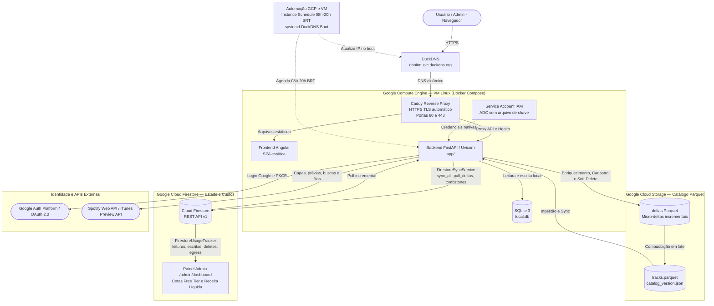

# Ribbit


[](https://github.com/gabrielGAGRA/Laboratorio_Engenharia_Software/actions/workflows/tests.yml)
[](https://github.com/gabrielGAGRA/Laboratorio_Engenharia_Software/actions/workflows/quality-gate.yml)


### Time: Crazy Frogs
- Carolina Britto Haddad
- Fernando Mendes Seraco
- Gabriel Agra de Castro Motta
- Mateus Silva de Araújo

### Divisão de Responsabilidades da Equipe
- **Arquitetura & CI**: Gabriel
- **Backend**: Carol, Fernando, Gabriel 
- **Bug Fix**: Fernando, Mateus
- **Dados/Cloud & CD**: Fernando
- **Documentação**: Carol, Fernando, Gabriel, Mateus
- **Frontend**: Carol, Mateus
- **Testes**: Carol, Fernando, Gabriel

> **Nota:** Mais detalhes nas abas de [Contributions](https://github.com/gabrielGAGRA/Ribbit-music-api-app/graphs/contributors?all=1) e histórico de commit dela.

## Sumário
- [Sobre](#sobre)
- [Divisão de Responsabilidades da Equipe](#divisão-de-responsabilidades-da-equipe)
- [Funcionalidades](#funcionalidades)
  - [Aplicativo](#aplicativo)
  - [Painel Administrativo](#painel-administrativo-web)
- [Descrição de Uso do Sistema](#descrição-de-uso-do-sistema)
- [Histórias de Usuário](#histórias-de-usuário)
- [Arquitetura e Tecnologias](#arquitetura-e-tecnologias)
  - [Ferramentas, Bibliotecas, Frameworks e SGBD](#ferramentas-bibliotecas-frameworks-e-sgbd)
  - [Mapeamento MVC e Arquitetura Hexagonal](#mapeamento-mvc-e-arquitetura-hexagonal)
  - [Diagrama de Componentes (MVC + Hexagonal)](#diagrama-de-componentes-mvc--hexagonal)
  - [Diagrama de Classes (UML — Domínio)](#diagrama-de-classes-uml--domínio)
  - [Diagrama Entidade-Relacionamento (DER)](#diagrama-entidade-relacionamento-der)
- [Arquitetura em Nuvem & Recursos GCP](#arquitetura-em-nuvem--recursos-gcp)
  - [Pipeline Cloud & Dados (GCP)](#pipeline-cloud--dados-gcp)
  - [Serviços GCP e Responsabilidades](#serviços-gcp-e-responsabilidades)
  - [Catálogo em Nuvem (GCS, Parquet & Delta Tables)](#catálogo-em-nuvem-gcs-parquet--delta-tables)
  - [Sincronização Híbrida e Controle de Custos (Firestore)](#sincronização-híbrida-e-controle-de-custos-firestore)
  - [Deploy em Produção (Compute Engine, HTTPS & Automação)](#deploy-em-produção-compute-engine-https--automação)
- [Protótipos da Interface](#protótipos-da-interface)
- [Como Executar (Ubuntu 26.04)](#como-executar-ubuntu-2604)
- [Fluxo de Execução para o Administrador / Avaliador](#fluxo-de-execução-para-o-administrador--avaliador)
- [Como Visualizar](#como-visualizar)
- [Testes Automatizados & Qualidade](#testes-automatizados--qualidade)
  - [Integração Contínua (CI/CD)](#integração-contínua-cicd)
- [Uso de IA](#uso-de-ia)

---

## Sobre

O **Ribbit** redefine a experiência de ouvir novas músicas através de uma mecânica interativa inspirada em *swipe*, usando da geração dinâmica de playlists e sessões colaborativas em tempo real (*Jams*).

O projeto é composto por duas frentes:
1. **Ribbit**: Aplicativo voltado ao usuário final para descoberta, criação de playlists inteligentes e interação social em grupo.
2. **Ribbit Admin Console**: Painel web restrito para curadoria de catálogo com *soft delete*, gestão de planos/usuários e monitoramento de métricas executivas.

---

## Funcionalidades

### Aplicativo

#### 1. Onboarding e Preferências
- Cadastro completo de usuários com validação de dados e autenticação via Google OAuth.
- Seleção personalizada de gêneros e artistas favoritos para alimentar as recomendações.
- Bloqueio de gêneros musicais indesejados, impedindo que faixas associadas exclusivamente a eles apareçam nas Descobertas e Playlists.

#### 2. Descoberta por Swipe
- Feed central de novas faixas que descarta músicas já avaliadas ou gêneros bloqueados.
- Avaliação gestual rápida:
  - **Like (Direita)**: Envia a música para as Curtidas.
  - **Superlike (Cima)**: Adiciona a faixa às Amadas e Curtidas em lista separada.
  - **Rejeitar (Esquerda)**: Remove a música de futuras recomendações e sugestões de playlists.
  - **Desfazer Ação (Premium Ribbit)**: Restaura a última faixa avaliada na Descoberta em caso de toque acidental; disponível nos planos pagos.

#### 3. Playlists Inteligentes e Contextuais
- **Montagem por Swipe**: Modo de adicionar músicas a uma playlist via gestos sem poluir a lista global de Curtidas.
- **Exportação para o Spotify**: Exportação direta da playlist para a biblioteca externa do usuário mediante conexão de conta Spotify (disponível tanto para contas Spotify Free quanto Premium).
- **Duração Exata**: Ajuste algorítmico da duração planejada com margem de erro máxima de $\pm 1$ minuto.
- **Lineup de Festivais**: Geração de sugestões baseada em artistas informados.
- **Filtros por Gênero e Época**: Criação de playlists filtradas por gênero musical e ano/época de lançamento.
- **Modo Referência**: Geração automática com base em Curtidas, Amadas ou playlists prévias.

#### 4. Jams Colaborativas (Pond)
- Criação de salas em grupo com convite por código de 6 dígitos para amigos.
- Sistema de pontuação coletiva por swipe: Like (+1), Deslike (0) e Superlike (+2 com destaque de prioridade).
- Votação democrática para pular músicas da fila em reprodução.
- Acompanhamento do tempo total e restante com margem de tolerância de $\pm 1$ minuto.
- **Sincronização com Fila do Spotify**: Envio em segundo plano das faixas mais votadas diretamente para a fila de reprodução ativa do anfitrião no Spotify.
- **Acesso ao Pond & Validação Spotify**: O recurso de reprodução colaborativa requer Spotify Premium, com tratamento de erros diferenciado na interface entre conta não conectada (modal guiando até as Configurações) e conta sem plano Premium (alerta informativo sem redirecionamento para o plano Ribbit).

#### 5. Busca e Comunidade
- Busca universal por faixa, artista, álbum ou gênero com filtro de nota mínima (`1★+` a `5★`), ordenação por avaliação e enriquecimento dinâmico de capas de álbuns (`cover_url`) com fallback entre GCS, Spotify e iTunes.
- Exibição do selo **Ouvido** em faixas já acessadas pelo usuário nas telas de Descoberta, Busca, Perfil, Coleções, Playlists, Jams e Detalhes da faixa.
- Feed comunitário com ordenação por curtidas, nota e data de publicação.
- Publicação e exclusão de comentários e avaliações comunitárias (1 a 5 estrelas, com opção de nota sem texto obrigatório) em cada música, exibindo metadados e capa da faixa avaliada.

#### 6. Perfil e Dados
- Gestão e edição de listas de Curtidas, Amadas, Rejeitadas e Artistas favoritos.
- Histórico de acessos persistente diretamente no Perfil (`/profile`), registrando reproduções, visualizações de detalhes, buscas, playlists e jams.
- Conexão e desconexão de conta do Spotify com suporte a OAuth e PKCE.
- Dashboard pessoal com artistas principais, gêneros predominantes, entre outras estatísticas.
- Exclusão transparente de dados sob solicitação do usuário.
- Edição e cancelamento do plano de assinatura (planos pagos restritos a maiores de 18 anos; menores podem usar o plano Free ou participar como dependentes no Plano Família).

#### 7. Restrições de conteúdo para menores
- Contas de menores não recebem nem podem interagir com faixas explícitas ou classificadas como Funk, Trap, Rap ou Hip Hop.
- A regra se aplica à descoberta, busca, decks de playlists e Jams, histórico e ações sobre faixas.
- Para menores, a busca externa não é usada como alternativa quando não há resultado local, pois os resultados externos não têm gênero confiável para aplicar o filtro.

---

### Painel Administrativo (Web)

#### 1. Gestão de Catálogo & Soft Delete
- Acesso seguro exclusivo para contas com permissão de administrador (`/admin/login`).
- Cadastro de novos conteúdos (`POST /api/admin/tracks`) com metadados completos diretamente pelo console administrativo (`/admin/moderation`), além de métricas de interação (likes, superlikes, dislikes) por faixa.
- Moderação de faixas (edição de gênero, classificação `+18`/explícita) e remoção de avaliações abusivas.
- **Soft Delete de Conteúdo**: Ao remover uma faixa, ela é ocultada das buscas públicas e das descobertas (`is_deleted = 1`), permanecendo registrada no histórico administrativo de acessos (`/admin/users`, aba **Histórico de Acessos**, com filtro por itens removidos) para integridade de dados e auditoria.

#### 2. Dashboard Executivo e Cálculo de Receita
- Visualização de acessos agrupados por conteúdo e por categoria/gênero no painel `/admin/dashboard`.
- Contagem dinâmica de usuários ativos sincronizada com a base.
- Cálculo da **Receita Líquida** da plataforma com base nas assinaturas ativas e na dedução de custos configuráveis de conteúdo e infraestrutura (`GET/PUT /api/admin/costs`).

#### 3. Gestão de Usuários, Administradores e Planos
- Listagem de assinantes por plano, promoção/rebaixamento de contas elegíveis a administrador e cadastro de novos administradores.
- Edição de planos de assinatura (nome, valor mensal e limite máximo de perfis vinculados).

---

## Descrição de Uso do Sistema

1. **Cadastro e Login**: Na tela inicial (`/auth`), o usuário cria sua conta informando nome, e-mail, data de nascimento, senha e plano inicial (menores de 18 anos podem se cadastrar no plano **Free** ou participar como dependentes no **Plano Família**, enquanto planos pagos exigem maioridade), ou realiza login com uma conta existente.
2. **Descoberta por Swipe (`/discover`)**: O usuário visualiza um card por vez com capa, metadados, selo **Ouvido** (quando já acessada) e prévia de áudio. Pode arrastar ou usar os botões para **Curtir** (direita), **Amar/Superlike** (cima), **Rejeitar** (esquerda), **Desfazer** (planos pagos, restaurando a faixa diretamente do backend) ou adicionar diretamente a uma playlist (`+`).
3. **Playlists Inteligentes (`/playlists`)**: Permite criar playlists com filtros de duração, gênero, artista ou época e montá-las via swipe sem afetar as Curtidas globais, além de gerenciar faixas e exportar para o Spotify.
4. **Jams Colaborativas (`/jams`)**: Usuários com Spotify Premium conectado criam uma sala (recebendo um código de 6 dígitos) ou entram em uma sala ativa para votar nas próximas faixas da fila e votar para pular a faixa atual.
5. **Busca e Comunidade (`/explore`)**: Permite buscar faixas por título, artista, álbum, gênero ou ano, filtrar por nota mínima (`1★+` a `5★`), ordenar por avaliação, ler o feed da comunidade e publicar/excluir avaliações (1 a 5 estrelas) e comentários.
6. **Perfil, Planos e Configurações (`/profile`, `/plans`, `/settings`, `/dashboard`)**: O usuário consulta suas coleções (Curtidas, Amadas, Rejeitadas), seu **Histórico de acessos**, suas avaliações publicadas, altera ou cancela o plano de assinatura, conecta/desconecta o Spotify, bloqueia gêneros indesejados (planos pagos) e visualiza seu dashboard anual.

---

## Histórias de Usuário

As 35 histórias de usuário (HU01–HU35), organizadas em 7 épicos com **Definição de Done (DoD)**, **tipo de usuário**, **tarefas e subtarefas**, **responsável** e **critérios de aceitação**, estão disponíveis no repositório:
- **Histórias de Usuário (HU01–HU35 e DoD):** [`docs/features/historias-de-usuario.md`](docs/features/historias-de-usuario.md)

---

## Arquitetura e Tecnologias

### Ferramentas, Bibliotecas, Frameworks e SGBD

#### Linguagens e Runtimes
| Tecnologia | Versão Exata | Finalidade |
| :--- | :--- | :--- |
| **Python** | `3.15` (`requires-python >= 3.15`) | Linguagem principal do backend, regras de domínio e testes |
| **TypeScript** | `6.0.2` (`npm:@typescript/typescript6@^6.0.2`) & `7.0.2` (`tsc --noEmit`) | Linguagem principal do frontend Angular e checagem estrita de tipos |
| **Node.js** | `22.x` (`node:22-bookworm-slim`) | Runtime de build, testes e servidor de desenvolvimento do frontend |

#### Backend (Python — `requirements.txt` & `pyproject.toml`)
| Biblioteca / Framework | Versão Exata | Finalidade |
| :--- | :--- | :--- |
| **FastAPI** | `0.163.1` | Framework web REST, roteamento e geração OpenAPI (`/docs`) |
| **Uvicorn** | `0.54.0` | Servidor ASGI para execução da API |
| **Pydantic** + **email-validator** | `2.14.3` (`pydantic-core==2.50.4`, `email-validator==2.4.0`) | Validação de esquemas de entrada/saída e configurações |
| **Starlette** + **AnyIO** | `1.10.0` / `4.16.0` | Camada ASGI subjacente e primitivos assíncronos |
| **Niquests** | `3.21.3` | Cliente HTTP para integrações externas (Spotify, iTunes, Google OAuth) |
| **Google Cloud Storage** | `3.17.1` | Leitura/compactação de catálogo no GCS e emulador local (`fake-gcs-server`) |
| **PyArrow** | `26.0.1` | Leitura e escrita do catálogo musical em formato Apache Parquet |
| **Pillow** | `13.0.0` | Processamento e validação de imagens de capa de playlists |
| **python-dotenv** | `1.2.4` | Carregamento de variáveis de ambiente via `.env` |

#### Frontend (TypeScript / Angular — `package.json`)
| Biblioteca / Framework | Versão Exata | Finalidade |
| :--- | :--- | :--- |
| **Angular** (`core`, `common`, `compiler`, `forms`, `platform-browser`, `router`) | `^22.2.3` | Framework SPA com componentes standalone e Signals |
| **Angular CLI & Build** (`@angular/cli`, `@angular-devkit/build-angular`) | `^22.2.4` | Empacotamento, proxy local da API e servidor `ng serve` |
| **RxJS** | `^7.8.2` | Programação reativa e interceptors HTTP |

#### SGBD e Armazenamento
| Tecnologia | Versão / Imagem | Finalidade |
| :--- | :--- | :--- |
| **SQLite 3** | `3.45+` (nativo no Python 3.15 / pacote `sqlite3` Ubuntu 26.04) | Banco relacional local/cache por instância; usado sozinho no desenvolvimento |
| **Google Cloud Firestore** | Firestore REST v1 | Sincronização compartilhada dos dados persistentes quando `FIRESTORE_ENABLED=true` no deploy |
| **fake-gcs-server (Emulador GCS)** | `fsouza/fake-gcs-server:latest` | Emulação local de bucket Google Cloud Storage para catálogo `.parquet` |

#### Infraestrutura, Qualidade, Linting, Tipagem e Testes
| Ferramenta | Versão Exata | Finalidade |
| :--- | :--- | :--- |
| **Docker Engine & Docker Compose** | `docker.io` `24.x+` / `docker-compose-v2` (`v2.x+`) / `nginx:alpine` | Orquestração local dos containers (`backend`, `frontend` servido via `nginx:alpine` e `gcs-emulator`) |
| **Pytest** + **pytest-cov** + **coverage** + **Hypothesis** | `9.2.0` / `7.1.0` / `7.17.3` / `6.170.17` | Suíte de testes unitários, propriedade e integração da API do backend (1007 testes, 89.21% de cobertura) |
| **Playwright** + **ffmpeg** | `1.65.1` (`@playwright/test`) / `ffmpeg` (Ubuntu) | Testes funcionais ponta a ponta no navegador e gravação de vídeos de execução (`npm run record:e2e`) |
| **Vitest** + **@vitest/coverage-v8** + **JSDOM** | `5.1.2` / `5.1.2` / `26.1.0` | Suíte de testes unitários e cobertura do frontend Angular (300 testes em 45 arquivos, 87.27% de linhas) |
| **Ruff** | `0.17.5` | Linter e formatador Python |
| **Pyrefly** | `1.4.1` | Verificador estático de tipos Python (`preset = "strict"`) |
| **Oxlint** + **oxlint-tsgolint** + **Oxfmt** | `1.88.0` / `7.0.2004` / `0.73.0` | Linting *type-aware* e formatação TypeScript/HTML/CSS |
| **ESLint** + **angular-eslint** | `10.13.0` / `22.6.0` | Regras de lint específicas para templates e componentes Angular |
| **uv** | `0.13.1` | Gerenciador de pacotes e ambientes Python |


---

### Mapeamento MVC e Arquitetura Hexagonal

O projeto combina **MVC (Model-View-Controller)** na divisão macro entre frontend e backend com **Arquitetura Hexagonal (Ports & Adapters)** e **DDD** dentro de `app/`:

| Camada MVC | Diretórios no Repositório | Responsabilidade e Coerência com o Código |
| :--- | :--- | :--- |
| **View** | `view/src/app/features/`<br>`view/src/app/shared/` | Interface SPA em Angular (componentes standalone, templates `.html`, estilos `.css`). Inclui as telas de autenticação/ouvinte (`auth`, `discover`, `playlists`, `jams`, `explore`, `profile` + `collection`, `family`, `plans`, `settings`, `dashboard`, `not-found`), os componentes compartilhados (`shared/`) e o painel administrativo (`admin/*`: `admin-login`, `admin-shell`, `admin-dashboard`, `admin-users`, `admin-plans`, `admin-moderation`). |
| **Controller** | `app/presentation/routers/`<br>`app/presentation/schemas/`<br>`app/presentation/dependencies/`<br>`app/application/use_cases/`<br>`app/application/dtos/`<br>`app/composition/`<br>`view/src/app/core/`<br>`view/src/app/features/*/*.service.ts` | **Backend:** Routers FastAPI (`auth.py`, `discovery.py`, `playlists.py`, `jams.py`, `tracks_reviews.py`, `profile.py`, `spotify.py`, `admin.py`) recebem requisições HTTP/REST, validam schemas Pydantic (`schemas/`) e delegam aos *Use Cases* (`use_cases/`), com injeção de dependências centralizada no *Composition Root* (`app/composition/container.py`).<br>**Frontend:** Serviços Angular com Signals, interceptors e guards (`RibbitStateService`, `SongService`, `PlaylistService`, `PlanService`, `AudioPlayerService`, `AuthSessionNotifier`, `authInterceptor` em `core/`, além de `AdminStateService`, `adminAuthGuard`, `DashboardService`, `JamService`, `AuthApiService`, `ProfileApiService` em `features/`). |
| **Model** | `app/domain/models/`<br>`app/domain/services/`<br>`app/application/ports/`<br>`app/infrastructure/` | **Domínio Puro:** Entidades/modelos (`Plan`, `User`, `Track`, `Playlist`, `Jam`, `JamQueueItem`, `Interaction`, `ReviewComment`, `TrackAccess`, `PlatformCostSettings`) e serviços/funções de domínio (`FamilyPlanService`, `SubscriptionAnalyticsService`, funções de recomendação em `recommendation.py`).<br>**Persistência & Adapters:** Repositórios SQLite (`SQLite*Repository`), adapters externos (`SpotifyAdapter`, `SpotifyUserProfileAdapter`, `ITunesAdapter`, `GoogleIdpVerifierAdapter`, `GoogleOAuthAdapter`, `GCSTrackCatalogAdapter`) e segurança (`PBKDF2PasswordHasher`, `HMACTokenService`) implementam os *ports*. |

---

### Diagrama de Componentes (MVC + Hexagonal)

O diagrama de componentes que ilustra a integração entre o frontend Angular (View/State), os roteadores e casos de uso (Controller/Application) e os modelos de domínio e adaptadores de infraestrutura (Model) está disponível no repositório:
- **Diagrama de Componentes (Mermaid):** [`docs/architecture/diagrama-componentes.md`](docs/architecture/diagrama-componentes.md)

---

### Diagrama de Classes (UML — Domínio)

O diagrama de classes UML com as entidades de domínio implementadas em `app/domain/models/`, seus atributos principais, métodos de negócio e relacionamentos está disponível no repositório:
- **Diagrama de Classes UML (Mermaid):** [`docs/architecture/diagrama-classes.md`](docs/architecture/diagrama-classes.md)

---

### Diagrama Entidade-Relacionamento (DER)

O esquema relacional completo do SQLite está implementado em [`app/infrastructure/repositories/schema.sql`](app/infrastructure/repositories/schema.sql) e documentado no repositório:
- **Diagrama Entidade-Relacionamento (Mermaid):** [`docs/database/DER.md`](docs/database/DER.md)
- **Diagrama Estático (Imagem):** [`docs/database/DER.png`](docs/database/DER.png)
- **Especificação DBML:** [`docs/database/DER.sql`](docs/database/DER.sql)
- **Módulos SQL:** [`docs/database/`](docs/database/)

---

## Arquitetura em Nuvem & Recursos GCP

O **Ribbit** combina persistência local de baixa latência em **SQLite** com serviços gerenciados do **Google Cloud Platform (GCP)** para armazenamento do catálogo musical, sincronização compartilhada entre instâncias, autenticação OAuth 2.0, governança de custos em tempo real e hospedagem automatizada em produção — mantendo paridade local via emulador (`fake-gcs-server`) para executar sem credenciais de nuvem.

### Pipeline Cloud & Dados (GCP)



### Serviços GCP e Responsabilidades

| Serviço / Recurso GCP | Implementação no Repositório | Finalidade |
| :--- | :--- | :--- |
| **Google Cloud Storage (GCS)** | [`app/infrastructure/adapters/gcp/gcs_track_catalog.py`](app/infrastructure/adapters/gcp/gcs_track_catalog.py)<br>[`scripts/sync_tracks.py`](scripts/sync_tracks.py) | Armazenamento do catálogo base em Apache Parquet (`Songs/tracks.parquet`), controle de versão (`Songs/catalog_version.json`) e persistência de *micro-deltas* incrementais (`Songs/deltas/`). |
| **Google Cloud Firestore** | [`app/infrastructure/adapters/gcp/firestore_client.py`](app/infrastructure/adapters/gcp/firestore_client.py)<br>[`app/infrastructure/adapters/gcp/firestore_sync.py`](app/infrastructure/adapters/gcp/firestore_sync.py) | Sincronização bidirecional via REST API v1 (compatível com Python 3.15, sem dependência de gRPC) das entidades operacionais entre instâncias. |
| **Google Auth Platform (OAuth 2.0 / GIS)** | [`app/infrastructure/adapters/google_auth_adapter.py`](app/infrastructure/adapters/google_auth_adapter.py) | Autenticação via Google Identity Services (`POST /api/auth/google`) e fluxo Authorization Code + PKCE (`GET /api/auth/google/authorize` e `/callback`). |
| **Google Compute Engine (VM) & Instance Schedules** | Infraestrutura de produção via Docker Compose | Hospedagem da aplicação em VM Linux com agendamento automático de liga/desliga (`08:00–20:00`, `America/Sao_Paulo`) para controle de custos. |
| **Cloud IAM (Service Account)** | [`app/config.py`](app/config.py)<br>[`gcp_credentials.json.example`](gcp_credentials.json.example) | Autenticação nativa via Application Default Credentials (ADC) na VM (`Storage Object Admin` e `Cloud Datastore User`), sem embutir chaves JSON na imagem Docker. |
| **Emulação Local (Dev)** | [`docker-compose.yml`](docker-compose.yml)<br>[`scripts/bootstrap_local_gcs.py`](scripts/bootstrap_local_gcs.py) | Container `fsouza/fake-gcs-server` (`STORAGE_EMULATOR_HOST`) permitindo executar toda a pilha de catálogo localmente sem credenciais GCP. |

### Catálogo em Nuvem (GCS, Parquet & Delta Tables)

- **Ingestão versionada:** Na inicialização ou via `POST /api/admin/catalog/sync` / `python -m scripts.sync_tracks` (com `--force` opcional), o `GCSTrackCatalogAdapter` baixa `Songs/tracks.parquet`, aplica eventuais *deltas* pendentes e sincroniza o SQLite local (`/data/local.db`) utilizando `Songs/catalog_version.json` para evitar reprocessamentos desnecessários.
- **Micro-deltas incrementais:** Enriquecimentos sob demanda (capas e prévias do iTunes/Spotify), novos cadastros administrativos (`POST /api/admin/tracks`), edições de moderação (`explicit`, `genre`) e *soft deletes* (`is_deleted = 1`) são gravados como arquivos Parquet individuais em `Songs/deltas/` seguindo esquema Arrow fixo (`_DELTA_PARQUET_SCHEMA`), evitando reescrever o catálogo completo a cada mutação.
- **Compactação em lote:** Acionável via painel administrativo (`POST /api/admin/catalog/compact`) ou CLI (`python -m scripts.sync_tracks --compact`), mescla todos os *deltas* pendentes no arquivo base `tracks.parquet` em lotes de `100.000` registros, incrementa a versão do catálogo e limpa os *deltas* já consolidados.
- **Paridade local sem credenciais:** Em desenvolvimento, `docker compose up --build` sobe o `fake-gcs-server` na porta `4443` e executa `scripts/bootstrap_local_gcs.py` automaticamente. Quando `GOOGLE_APPLICATION_CREDENTIALS` aponta para uma credencial real, `app/config.py` limpa automaticamente `STORAGE_EMULATOR_HOST` apontando para `localhost:4443`.

### Sincronização Híbrida e Controle de Custos (Firestore)

- **Arquitetura híbrida (SQLite + Firestore):** O SQLite atende leituras e consultas complexas em baixa latência enquanto o `FirestoreSyncService` mantém o estado compartilhado no Cloud Firestore (obrigatório quando `ENVIRONMENT=production`, validado em [`app/config.py`](app/config.py)).
- **Chaves determinísticas e delta pull:** Utiliza IDs determinísticos (SHA-256 de e-mails e chaves de faixa) para evitar duplicação entre máquinas, sincronização completa no startup (`sync_all`), *pulls* incrementais por `updated_at` com janela de sobreposição de 60 segundos (`pull_deltas`) e *tombstones* (`is_deleted`) para propagar exclusões.
- **Monitoramento de cotas e Receita Líquida:** O [`FirestoreUsageTracker`](app/infrastructure/repositories/firestore_usage_tracker.py) contabiliza operações e tráfego em `firestore_usage_counters`, e [`subscription_analytics_service.py`](app/domain/services/subscription_analytics_service.py) calcula o percentual consumido do Free Tier e projeta o custo mensal excedente em USD, somado ao custo fixo de infraestrutura padrão (`USD 25,00/mês` configurável em [`platform_costs.py`](app/domain/models/platform_costs.py) e `GET/PUT /api/admin/costs`) no painel `/admin/dashboard`:

| Métrica Firestore | Franquia Gratuita (Free Tier) | Tarifa Excedente (USD) |
| :--- | :--- | :--- |
| **Leituras** | `50.000` / dia | `USD 0,06` / 100k operações |
| **Escritas** | `20.000` / dia | `USD 0,18` / 100k operações |
| **Exclusões** | `20.000` / dia | `USD 0,02` / 100k operações |
| **Armazenamento** | `1,0 GiB` | `USD 0,18` / GiB·mês |
| **Saída de Rede (Egress)** | `10,0 GiB` / mês | `USD 0,12` / GiB |

### Deploy em Produção (Compute Engine, HTTPS & Automação)

- **Topologia em produção:** VM Linux (Ubuntu x86_64) no Google Compute Engine executando o backend FastAPI/Uvicorn (com volume persistente para `/data/local.db`), os arquivos estáticos compilados do Angular e o *reverse proxy* **Caddy** nas portas `80`/`443` com emissão e renovação automática de certificados TLS via Let's Encrypt (mantendo a porta interna `8000` fechada externamente).
- **DNS dinâmico e boot automatizado:** Domínio HTTPS via DuckDNS (`ribbitmusic.duckdns.org`) atualizado automaticamente na inicialização da VM por um serviço `systemd`, garantindo disponibilidade mesmo com IP efêmero após reinícios.
- **Otimização de custos (Instance Schedules):** Agenda nativa do Compute Engine configurada para ligar/desligar a VM automaticamente (`08:00–20:00`, fuso `America/Sao_Paulo`), interrompendo a cobrança de CPU/RAM fora do horário de uso enquanto o disco persistente e os containers (`restart: unless-stopped`) retomam o serviço automaticamente.
- **Configuração por variáveis de ambiente:** Todas as integrações GCP (`GCS_BUCKET_NAME`, `GCS_TRACKS_FILE_PATH`, `FIRESTORE_ENABLED`, `GCP_PROJECT_ID`, `FIRESTORE_DATABASE`, `GOOGLE_CLIENT_ID`, `GOOGLE_CLIENT_SECRET`, `GOOGLE_REDIRECT_URI`, `GOOGLE_APPLICATION_CREDENTIALS`) estão centralizadas em [`.env.example`](.env.example) e validadas em [`app/config.py`](app/config.py).

---

## Protótipos da Interface

Os protótipos de alta e baixa fidelidade das telas do aplicativo e do fluxo de swipe estão disponíveis no repositório:
- **Protótipo de Telas (PDF completo):** [`docs/view/prototype/Protótipo de Telas Ribbit.pdf`](docs/view/prototype/Protótipo%20de%20Telas%20Ribbit.pdf)
- **Ideação Crazy 8 (rascunhos iniciais da equipe):**
  - [`Crazy8.jpeg`](docs/view/prototype/Crazy8.jpeg) — Consolidação
  - [`Crazy8-Carol.jpeg`](docs/view/prototype/Crazy8-Carol.jpeg) — Carolina Britto Haddad
  - [`Crazy8-Fernando.jpeg`](docs/view/prototype/Crazy8-Fernando.jpeg) — Fernando Mendes Seraco
  - [`Crazy8-Gabriel.jpeg`](docs/view/prototype/Crazy8-Gabriel.jpeg) — Gabriel Agra de Castro Motta
  - [`Crazy8-Mateus.jpeg`](docs/view/prototype/Crazy8-Mateus.jpeg) — Mateus Silva de Araújo

---

## Como Executar (Ubuntu 26.04)

### Local com Docker Composer

Instale o Docker Engine e o plugin Docker Compose no Ubuntu 26.04 (caso ainda não possua) e adicione seu usuário ao grupo `docker`:
```bash
sudo apt-get update && sudo apt-get install -y ca-certificates curl git
sudo apt-get install -y docker.io docker-compose-v2
sudo systemctl enable --now docker
sudo usermod -aG docker "$USER" && newgrp docker
```

Com o Docker e o Docker Compose instalados, suba o frontend, o backend (com carga automática de [`database/dump.sql`](database/dump.sql)) e o emulador de armazenamento em nuvem (Google Cloud Storage local) com persistência em volumes e sem precisar de credenciais de nuvem:

```bash
docker compose up --build
```

- **Frontend**: [http://localhost:4200](http://localhost:4200)
- **Backend API**: [http://localhost:8000](http://localhost:8000) (documentação interativa em `/docs`)
- **Emulador GCS**: [http://localhost:4443](http://localhost:4443)

### Contas de Teste (de `database/dump.sql`)
- **Administrador**: `admin@ribbit.example.com` / `RibbitLocal2026!`
- **Usuário Adulto (Plano Individual)**: `usuario@ribbit.example.com` / `RibbitUser2026!`
- **Usuário Menor de Idade (Plano Free)**: `menor@ribbit.example.com` / `RibbitUser2026!`
- **Usuário Família (Plano Família)**: `familia@ribbit.example.com` / `RibbitUser2026!`

---

## Fluxo para Administrador

Acesse o painel de admin em [http://localhost:4200/admin/login](http://localhost:4200/admin/login).

Siga o passo a passo abaixo para validar todas as funcionalidades administrativas e do aplicativo após subir o ambiente:

1. **Acessar o Login Administrativo:**
   - Abra [http://localhost:4200/admin/login](http://localhost:4200/admin/login) no navegador.
   - Insira diretamente as credenciais de administrador configuradas em [`app/config.py`](app/config.py):
     - **E-mail:** `admin@ribbit.example.com`
     - **Senha:** `RibbitLocal2026!`
   - Clique em entrar (requisição `POST /api/admin/login` validada pelo `adminAuthGuard`).

2. **Visão Executiva e Cálculo de Receita (`/admin/dashboard`):**
   - Ao entrar, o menu lateral exibe **Visão Executiva**.
   - Verifique o total de usuários ativos, a distribuição por planos, os gêneros mais bloqueados, o ranking de acessos por conteúdo e por categoria (gênero), e o demonstrativo financeiro da **Receita Líquida** (receita bruta menos custos configuráveis de conteúdo e infraestrutura via `GET/PUT /api/admin/costs`).

3. **Gestão de Usuários & Administradores (`/admin/users`):**
   - No menu lateral, clique em **Usuários & Admins**.
   - Consulte a listagem de usuários cadastrados e seus planos vinculados, promova/gerencie contas elegíveis a administrador, cadastre um novo administrador ou consulte a aba **Histórico de Acessos** (`GET /api/admin/access-history`, preservando inclusive faixas removidas via Soft Delete).

4. **Gestão de Planos & Preços (`/admin/plans`):**
   - No menu lateral, clique em **Planos & Preços**.
   - Edite o nome, a mensalidade ou a cota máxima de perfis vinculados de um plano e observe a atualização refletida no cálculo executivo.

5. **Moderação de Catálogo & Soft Delete (`/admin/moderation`):**
   - No menu lateral, clique em **Moderação**.
   - Cadastre novas faixas no catálogo (`POST /api/admin/tracks`), pesquise e ordene faixas por métricas de interação (likes, superlikes e dislikes via `GET /api/admin/tracks`), altere a classificação `+18` (`explicit`) e teste a ação de **Soft Delete** em uma faixa (ela deixa de aparecer nas buscas públicas e no feed de descoberta, preservando os registros no histórico administrativo).
   - Na mesma seção, visualize e remova avaliações abusivas da comunidade.

6. **Alternar para o App Ouvinte (`/discover`):**
   - No rodapé do menu lateral ou no cabeçalho superior, clique em **Ir para App Ouvinte** para navegar até `/discover` e testar o fluxo de swipe, playlists inteligentes, Jams (Pond), busca com filtros de nota mínima e ordenação por avaliação, selo **Ouvido** em faixas já acessadas e restrições de conteúdo para menores (`menor@ribbit.example.com`).


---

## Testes Automatizados & Qualidade

A suíte de testes é organizada em quatro frentes independentes:

- **`tests/unit/`**: testes unitários do backend (domínio, casos de uso, adaptadores e routers isolados).
- **`tests/integration/`**: testes de integração da API FastAPI + SQLite em memória (`test_e2e_flow.py`, `test_client.py`, `test_admin_analytics_flow.py` e `test_track_access_flow.py`).
- **`tests/e2e/`**: testes funcionais ponta a ponta no navegador com Playwright (`*.e2e.ts`), exercitando `view/` + `app/` + banco SQLite juntos nos 5 fluxos (incluindo o painel administrativo `/admin/*`), com gravação de vídeo `.mp4` (H.264, 1080p).
- **`view/src/app/**/*.spec.ts`**: testes unitários do frontend Angular co-localizados com componentes e serviços (Vitest).

### Backend (Python)
- **Executar suíte de testes unitários e de integração:**
  ```bash
  source .venv/bin/activate
  python -m pytest
  ```
- **Verificar cobertura de código (meta mínima de 85% configurada em [`pyproject.toml`](pyproject.toml)):**
  ```bash
  python -m pytest --cov=app --cov-report=term-missing --cov-fail-under=85
  ```
- **Quality Gate Python (formatação, lint e tipagem estrita):**
  ```bash
  ruff format --check app tests
  ruff check app tests
  pyrefly check
  ```

### Testes Funcionais Web (Playwright) & Vídeos
- **Instalar o navegador Chromium e dependências de sistema no Ubuntu (primeira execução):**
  ```bash
  npx playwright install --with-deps chromium
  ```
- **Pré-requisito para gravação de vídeos (`record:e2e`):** instale o `ffmpeg` (`sudo apt-get install -y ffmpeg`).
- **Executar os testes E2E no navegador (5 fluxos funcionais distintos):**
  ```bash
  npm run test:e2e
  ```
- **Executar os testes E2E e exportar os 5 vídeos gravados para `docs/videos/`:**
  ```bash
  npm run record:e2e
  ```

| Fluxo E2E | Teste Playwright | Vídeo Gravado |
| :--- | :--- | :--- |
| **1. Onboarding, Filtros de Gênero, Swipe e Coleções** | [`01-onboarding-discovery-swipe.e2e.ts`](tests/e2e/01-onboarding-discovery-swipe.e2e.ts) | [`01-onboarding-discovery-swipe.mp4`](docs/videos/01-onboarding-discovery-swipe.mp4) |
| **2. Playlists Contextuais e Fila de Reprodução** | [`02-contextual-playlists-and-queue.e2e.ts`](tests/e2e/02-contextual-playlists-and-queue.e2e.ts) | [`02-contextual-playlists-and-queue.mp4`](docs/videos/02-contextual-playlists-and-queue.mp4) |
| **3. Jam Colaborativa (Pond), Votação e Skip** | [`03-collaborative-jam-pond.e2e.ts`](tests/e2e/03-collaborative-jam-pond.e2e.ts) | [`03-collaborative-jam-pond.mp4`](docs/videos/03-collaborative-jam-pond.mp4) |
| **4. Busca no Catálogo, Reviews e Comunidade** | [`04-explore-search-and-community-reviews.e2e.ts`](tests/e2e/04-explore-search-and-community-reviews.e2e.ts) | [`04-explore-search-and-community-reviews.mp4`](docs/videos/04-explore-search-and-community-reviews.mp4) |
| **5. Painel Administrativo, Planos e Moderação** | [`05-admin-console-governance-and-moderation.e2e.ts`](tests/e2e/05-admin-console-governance-and-moderation.e2e.ts) | [`05-admin-console-governance-and-moderation.mp4`](docs/videos/05-admin-console-governance-and-moderation.mp4) |

### Frontend (TypeScript / Angular)
- **Executar testes unitários (300 testes em 45 arquivos com Vitest):**
  ```bash
  npm test
  ```
- **Verificar cobertura de código (meta mínima de 85% configurada em [`vitest.config.ts`](vitest.config.ts)):**
  ```bash
  npm run test:cov
  ```
- **Checar tipagem estrita com TypeScript 7:**
  ```bash
  npm run typecheck
  ```
- **Quality Gate Frontend (Oxlint, Angular ESLint e formatação):**
  ```bash
  npm run lint
  npm run format:check
  ```
- **Gerar build de produção:**
  ```bash
  npm run build
  ```

### Integração Contínua (CI/CD)
Os fluxos do GitHub Actions validam automaticamente cada `push` e `pull_request`:
- **Testes ([`.github/workflows/tests.yml`](.github/workflows/tests.yml)):** executa `pytest` com verificação de cobertura $\ge 85\%$ (`backend-tests`), suíte unitária Angular com `vitest` (`npm run test:cov`, `frontend-tests`) e testes ponta a ponta em navegador com Playwright (`e2e-browser-tests`, publicando traces/screenshots em caso de falha).
- **Quality Gate ([`.github/workflows/quality-gate.yml`](.github/workflows/quality-gate.yml)):** valida formatação e lint Python (`ruff format --check`, `ruff check`), tipagem estrita Python (`pyrefly check`), formatação/tipagem/build/lint *type-aware* TypeScript (`npm run format:check`, `npm run typecheck`, `npm run build`, `npm run lint:ts`) e lint de templates/componentes Angular (`npm run lint:angular`).

---

## Uso de IA

A documentação completa do uso de ferramentas de Inteligência Artificial generativa neste projeto — incluindo prompts utilizados, modelos (LLMs) e respectivas versões — está registrada em [`docs/llm-use-declaration/`](docs/llm-use-declaration/).
