# Diagrama de Classes (UML — Domínio)

O diagrama abaixo representa as entidades de domínio implementadas em `app/domain/models/`, com seus atributos principais, métodos de negócio e relacionamentos:

```mermaid
classDiagram
    class Plan {
        +int? plan_id
        +str name
        +float monthly_price
        +int max_profiles
        +bool is_paid
        +bool allows_dependents
        +can_accommodate(total_profiles: int) bool
        +can_accommodate_new_dependent(current_dependents: int) bool
        +update_name(new_name: str) Plan
        +update_price(new_price: float) Plan
        +update_max_profiles(new_max: int) Plan
    }

    class User {
        +int? user_id
        +str email
        +str password_hash
        +str display_name
        +int? age
        +str? birth_date
        +int plan_id
        +int? primary_account_id
        +frozenset~str~ blocked_genres
        +frozenset~str~ favorite_genres
        +str preferred_theme
        +bool is_admin
        +str? spotify_id
        +bool spotify_premium
        +str? spotify_access_token
        +str? spotify_refresh_token
        +datetime? spotify_token_expires_at
        +datetime? created_at
        +bool is_adult
        +current_age(today: date?) int
        +is_minor() bool
        +restricted_genre_terms() tuple~str~
        +can_listen(track: Track) bool
        +is_track_restricted_for_minor(track: Track) bool
        +link_primary_account(primary_account_id: int) User
        +unlink_primary_account(fallback_plan_id: int) User
        +change_plan(plan_id: int) User
        +promote_to_admin() User
        +link_spotify(spotify_id: str) User
        +unlink_spotify() User
        +update_spotify_premium(is_premium: bool) User
        +update_spotify_tokens(access_token: str?, refresh_token: str?, expires_at: datetime?) User
        +update_blocked_genres(genres: Iterable~str~) User
        +update_favorite_genres(genres: Iterable~str~) User
        +update_preferred_theme(theme: str) User
        +update_profile(display_name: str?, password_hash: str?) User
        +is_favorite_genre(track: Track) bool
        +recommendation_weight(track: Track, favorite_multiplier: float?) float
    }

    class Track {
        +int? track_id
        +str title
        +str artist
        +int duration_seconds
        +str genre
        +str? spotify_id
        +str? album
        +str? country
        +int? release_year
        +str? cover_url
        +str? itunes_preview_url
        +bool explicit
        +bool is_deleted
        +datetime? created_at
        +float? average_rating
        +int review_count
        +set_explicit(explicit: bool) Track
        +has_known_genre() bool
        +set_genre(genre: str) Track
        +merge_missing_metadata(...) bool
        +refresh_catalog_metadata(...) Track
        +mark_as_deleted() Track
        +restore() Track
    }

    class Playlist {
        +int? playlist_id
        +int user_id
        +str name
        +str? description
        +str? spotify_playlist_id
        +str? cover_image_url
        +bool is_exported
        +datetime? created_at
        +int? max_duration_seconds
        +str? deck_filters
        +int? source_playlist_id
        +tuple~Track~ tracks
        +int total_duration_seconds
        +is_owned_by(user_id: int) bool
        +can_fit_duration(additional_seconds: int) bool
        +add_track(track: Track) Playlist
        +remove_track(track_id: int) Playlist
        +replace_tracks(tracks: Sequence~Track~) Playlist
        +export(spotify_playlist_id: str) Playlist
    }

    class Jam {
        +int? jam_id
        +int host_user_id
        +str room_name
        +str room_code
        +bool is_active
        +int? current_track_id
        +datetime? created_at
        +int duration_minutes
        +int max_superlikes
        +int superlikes_used
        +int skip_votes_threshold
        +int accumulated_duration_seconds
        +str deck_source
        +int? source_playlist_id
        +int max_duration_seconds
        +generate_room_code() str
        +create(host_user_id: int, room_name: str, ...) Jam
        +is_host(user_id: int) bool
        +can_use_superlike() bool
        +use_superlike() Jam
        +is_duration_exceeded() bool
        +add_accumulated_duration(seconds: int) Jam
        +set_current_track(track_id: int?) Jam
        +close() Jam
    }

    class JamQueueItem {
        +int? jam_queue_id
        +int jam_id
        +int track_id
        +int vote_points
        +datetime? added_at
        +vote(points: int) JamQueueItem
    }

    class Interaction {
        +int? interaction_id
        +int user_id
        +int track_id
        +InteractionAction action
        +InteractionSource? source
        +int? jam_id
        +datetime? created_at
        +bool is_positive
        +change_action(new_action: InteractionAction) Interaction
    }

    class ReviewComment {
        +int? review_id
        +int user_id
        +int track_id
        +int rating
        +str? text
        +int likes_count
        +bool is_deleted
        +datetime? created_at
        +str? author_name
        +str? track_title
        +str? track_artist
        +str? track_image
        +is_valid_rating(rating: int) bool
        +like() ReviewComment
        +mark_as_deleted() ReviewComment
        +update_content(new_rating: int, new_text: str?) ReviewComment
    }

    class TrackAccess {
        +int? access_id
        +int user_id
        +int track_id
        +TrackAccessSource source
        +datetime? accessed_at
    }

    class PlatformCostSettings {
        +float content_cost_per_track
        +float infrastructure_fixed_cost
        +float infrastructure_cost_per_user
        +datetime? updated_at
    }

    Plan "1" <-- "0..*" User : assina
    User "0..1" <-- "0..*" User : titular / dependente
    User "1" --> "0..*" Playlist : possui
    Playlist "0..*" o-- "0..*" Track : contém
    Playlist "0..1" <-- "0..*" Playlist : referencia
    User "1" --> "0..*" Jam : hospeda
    Jam "1" *-- "0..*" JamQueueItem : fila
    JamQueueItem "0..*" --> "1" Track : referencia
    Jam "0..*" --> "0..1" Track : faixa atual
    Jam "0..*" --> "0..1" Playlist : deck base
    User "1" --> "0..*" Interaction : realiza
    Track "1" <-- "0..*" Interaction : avaliada em
    Jam "0..1" <-- "0..*" Interaction : origem
    User "1" --> "0..*" ReviewComment : publica
    Track "1" <-- "0..*" ReviewComment : recebe
    User "1" --> "0..*" TrackAccess : registra acesso
    Track "1" <-- "0..*" TrackAccess : acessada em
```

