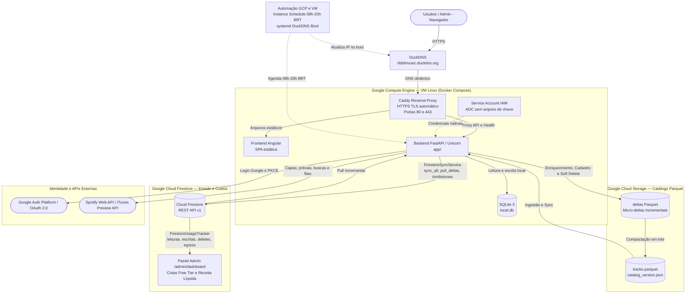

# Diagrama de Arquitetura em Nuvem & Pipeline GCP

Pipeline de dados, hospedagem em produção no Google Compute Engine, armazenamento do catálogo em Parquet no Google Cloud Storage, sincronização e controle de custos no Cloud Firestore e autenticação/APIs externas do **Ribbit**.

