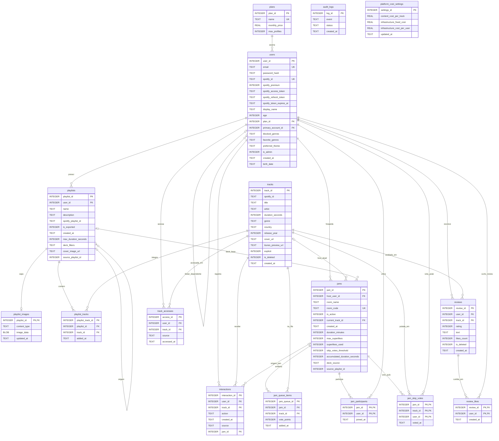

# Diagrama Entidade-Relacionamento (DER)

O esquema relacional completo do SQLite está implementado em [`app/infrastructure/repositories/schema.sql`](../../app/infrastructure/repositories/schema.sql), documentado em DBML em [`DER.sql`](DER.sql) e nos módulos SQL em [`docs/database/`](./), sendo representado tanto pelo diagrama estático [`DER.png`](DER.png) quanto pelo diagrama Mermaid abaixo:

